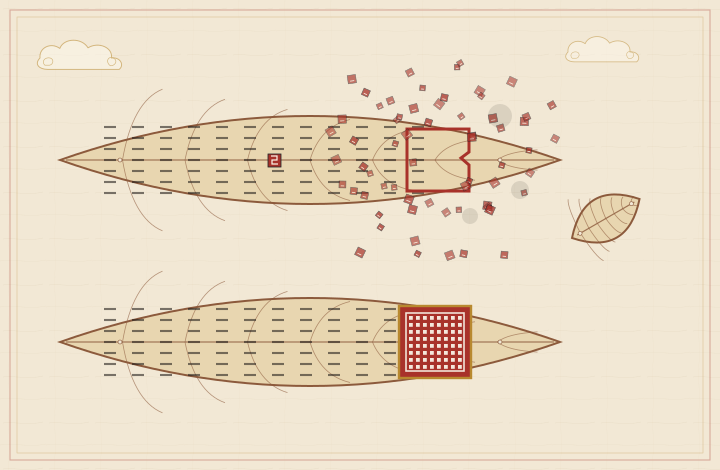
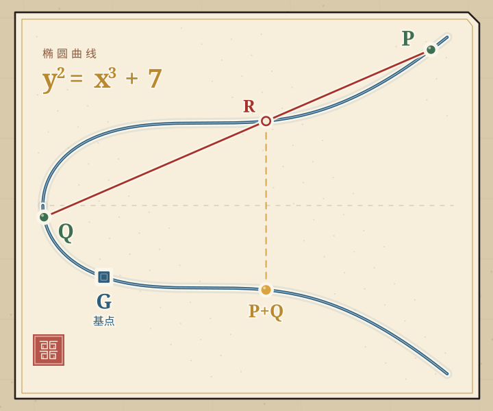
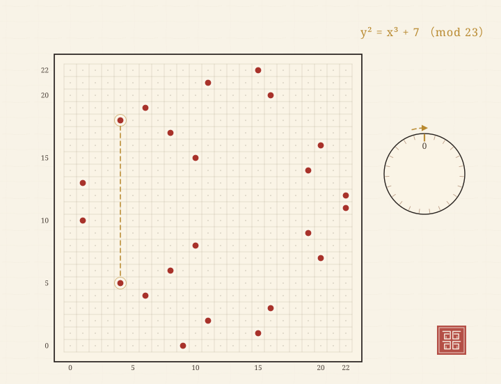
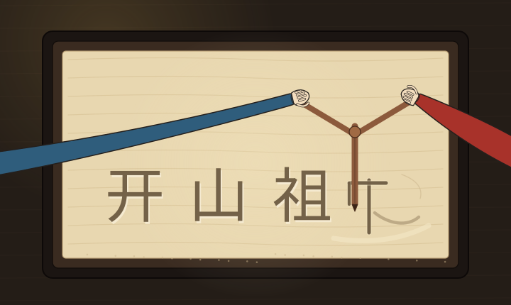
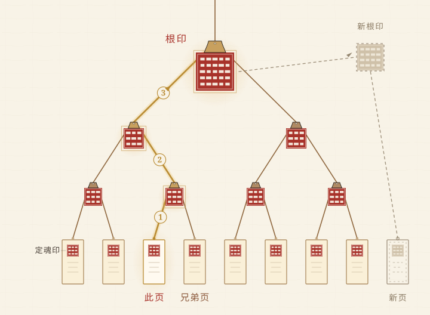
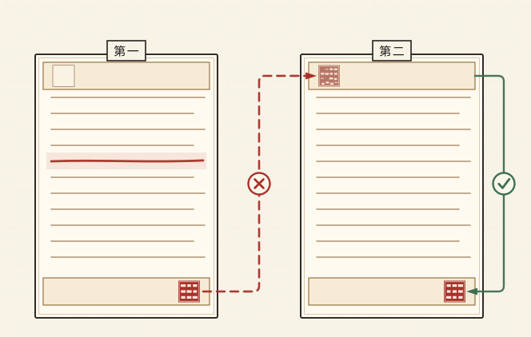
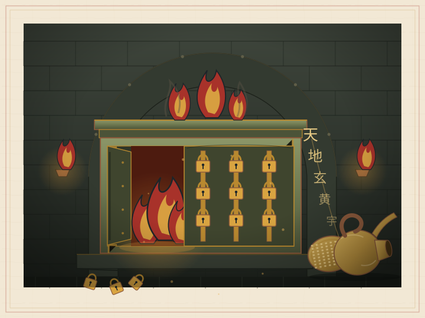

# 天枢账簿

## 一部古风推理科幻，也是一篇区块链科普


<!--epigraph-->

天枢阁一共九层，收着 10000 本账。

其中 372 页，是我亲手抄的。每抄完一页，须在页脚盖一枚“定魂印”。这印没有刀口，也没有篆字。只要把整页文字按顺序塞进印炉，炉子就会从 64 个孔里吐出 64 字的印章，那就是定魂印。

我 15 岁那年，这 372 页丢了！

丢得那叫一个干净。没有涂改，没有刮痕，连纸毛都没翘起一根。账房的本子齐整得很。我刷刷地翻过大家抄的账，像给死人合眼。体面，而且绝不回头。

我叫沈拾遗。“拾遗”，就是替人捡丢了的东西。

这名字成了全天枢阁最大的笑话，因为丢东西的人是我。

<!--/epigraph-->

# 楔子　多出来的一笔

我 15 岁生日的第二天，阿砚念账，念到第 372 笔，卡住了。

他卡得很奇怪。声音还吊在嗓子眼，气先断了，像被杀手从背后掐死。

抄算房在塔的三楼。这里的窗纸糊了三层，密不透风。墨水干得慢，人也提不起精神，全靠一口早茶吊着。每天开工前，弟子们要互核昨天的账：一个念，一个对。一千多人同时开嗓，听着像下雨打瓦，像有人在楼上哗啦啦倒豆子。

整间屋子里，只有阿砚这一颗豆子掉在了地上。

他把册子翻过去，又翻回来。耳朵尖先红了，红着红着，连脖子也红透了。

“沈师兄，”他说，“你这一页……是空的！”

我一把抢过册子。

我名下那一栏，本该写着：抄账 372 笔，“无一错漏”。现在这一栏没了！纸面干干净净，手摸上去一马平川。斜着对光看，也不反光。

我娘教过我辨认涂改。指甲刮纸会起毛。明矾水洗过会发黄。刀片刮过，会留下一道白得发亮的沟。可眼前这页什么痕迹都没有，倒像是有人把整层纸揭走，再贴上一张新的，接缝藏进了纸纤维里，拿针尖也挑不出来！

我脑子里嗡的一片安静，静到能听见自己磨墨的声音。手还在磨呢。一圈，一圈，满满 108 圈。抄算房的规矩：多一圈少一圈，都得重磨。打工牛马的肌肉记忆有多可怕？大概就是天塌下来把楼砸了，手上的墨也不能磨歪。

“不对！”我说。

阿砚把他自己的抄本推过来。我那页功德好好地躺在上面，墨迹新得像刚写完，“无一错漏”四个字端端正正。

我松了口气，只松了半口。

那……为什么我这本是空的？

答案在我合册的时候冒了出来。页脚多了一行小字，笔迹我认得，是账房的手笔：

“沈拾遗功德 372 笔，转讫。印痕验讫。”

转讫？我的功德，被人转账偷走了！

走的是正规账，盖的是正规印，验的是正规印痕。账房写下这行字，一笔一画稳得像拿尺子比过，签得比给活人报喜还无聊。

我摸出私册。那是我自己的账，372 页，一页一页抄，一页一页盖定魂印，缝在内衫夹层里，睡觉都压着。我把它泡进验墨水。

纸一入水，页脚的印就浮了上来，像水面上一层薄薄的油花，纹路清清楚楚。定魂印是真实有效的。它一点火气都没有。

我又把公册那一页也泡进去。空白的纸面上，那行“转讫”的印同样浮了起来。它也是真的。

两枚真印，一本空账！

我盯着那行“转讫”，看了很久。久到阿砚以为我中风了，伸手在我眼前晃了晃。

“沈师兄？”

“阿砚，”我说，“你昨天念账，念到第 371 笔的时候，我应了吗？”

“应了。”

“第 372 笔呢？”

他愣了愣。“第 372 笔……没念到。念到那儿就没了。”

我点点头。

天枢阁的规矩，叫万份制度：每一页账，全阁 10000 本抄本各记一份。按阁里的规矩，想改我这一页，得同时改 10000 本，还得保证这 10000 个人低头看自己手里的账。隔壁威尼斯的复式记账法要三五百年后才会出现，而且可靠性远不及我们呢。谁都没觉得哪里不对。

我 15 岁，抄账三年，一天没落下。全阁的人都管我叫“小数点”，因为我一笔都不肯错。

小数点不会骗人。

后来我才知道，会骗人的，恰恰是账。

> **【天枢阁·案卷】第一卷　万份制度**
>
> 天枢阁就是区块链。区块就是一页账，里面是用户之间的转账记录。账本保存在区块链网络里的机器节点。定魂印是哈希（Hash）函数，也叫散列函数，用于核对账本的完整性。万份制度，是让大量参与者各自保存和验证账本。区块链的最终目的是让所有参与者共识到一个全局唯一，不可篡改的账目事实。
>
> 现实里的区块链网络内有大量机器节点。每个区块链节点都按同一套规则验账，只承认验证通过、且有史以来区块高度（账本总页数）最大的那条链。参与共识和验证的副本越多，偷偷造一条假链越难。
>
> 常规互联网的世界里，记账都是由单个中心化机构完成的，例如银行或电商平台。但中本聪 2008 年的比特币白皮书，定义了“一个点对点的电子现金系统”[1]。区块链没有中心总账房。每个全节点手里有一整本账，而轻节点只存一些定魂印，要验的时候再问别人取账目数据。新的账页区块一出，就广播给所有人各自验证。谁也没法一个人偷偷改历史。
>
> 但也别只急着鼓掌。区块链只能防住篡改全局历史，防不了坏人偷你一个人的钱，删你一个人的账。钓鱼授权、私钥泄露、合约漏洞，都会让别人掌控你的账户。别人用你的账户转走钱，链上每一步都按规矩执行，所以区块链防不了你自己的钱被偷。这就好比银行金库再结实，也拦不住你亲手把密码报给电话那头的“客服”。

---

# 第一章　定魂印

醉山先生住在塔顶，两条腿悬在 3000 丈的半空里晃荡。

塔顶是水运仪象台。浑仪、浑象、报时木人，全阁的时辰都归这台铜机器管。它一昼夜转一圈。醉山先生的酒壶就搁在浑仪底座上，年深日久，铜座被壶底磨出一圈浅坑，像一枚用旧了的印。

“你确定，那一页被人动过？”他问。

“是。”

“那拿你的册子，去跟母本对。”他晃了晃酒壶，“对完再来。”

藏经阁在塔的第六层。母本锁在一只铁函里，函盖上压着九叠篆的封条。墨三大师傅蹲在函前，拿机关钥“咔、咔、咔”拨了三下，铁函应声而开。

母本是祖本的第一部抄本。祖本供在塔基底下的金匮里，九道锁，锁眼里灌了铅，谁也进不去。母本抄出来，是给活人看的：祖本每添一页，母本就跟着抄一页。塔里每 20 年对祖本描一次叶。开金匮，请出祖本，先照它把母本从头重抄一遍，封好母本，再重描祖本。所以祖本上再旧的批字，母本也带着。阁里说“对账”，对的是母本。说“改账”，改的是祖本。

墨三是墨家机关师，31 岁，手上常年一层墨渍加铜绿，指关节比常人粗一圈，拧螺丝拧的。他修转轮藏，修机关鸢，修水运仪象台，但不信神仙，只信榫卯。

“三毫。”他忽然开口。

“什么三毫？”

“你这册子，书脊比标准本薄了三毫。”他拿拇指在书脊上蹭了一下，“原装的不该这么薄。有人拆过线，重新缝的，用的还是旧线，所以看着像没动过。”

母本摊开，我那页功德也在。372 笔，“无一错漏”，跟阿砚那本一字不差。

只有我手里这本是空的。

我抱着两本册子坐在藏经阁的石阶上，把这笔账来回盘算。母本记得，各宗门的抄本记得。全天下都记得我有 372 笔功德，偏偏只有我这一本把它忘了？那我这个“忘”，到底算什么？

“不算什么。”墨三不知什么时候蹲到了我旁边，正拿麂皮擦他的机关钥，“账在众，不在一。你可还记得为什么改一页账，瞒不过 10000 本抄本？”

“因为对得上。”

“怎么对？”

“每页都有定魂印。”

这是抄算弟子的第一课。每一页账抄完，都要盖一枚定魂印。印不只是用机关刻出来的，更是从账页里自己“长”出来的：把页上所有文字按次序喂进一套固定的算路，吐出一个数，这个数就是印。同样的字，同样的次序，喂进去，吐出来的永远是同一个数。

算路装在一只印炉里。印炉是青铜的，炉身铸着 64 个孔，每孔一个字。竹简从炉口塞进去，炉膛里的铜珠顺着 64 道槽滚下，最后从 64 个孔里吐出 64 个字。同样的文字进去，永远是同样的 64 个字吐出来。账页哪怕改一个字，这 64 个字也立刻面目全非。

我背过它的三条脾气。

第一条：单向。只看定魂印，不可能还原账页。好比猪肉绞成了馅，谁也没法把肉馅还原成那头猪。又像地上的脚印，只能告诉你有人来过、脚这么大，推不出他今天穿的什么衣服什么袜子。



第二条：雪崩。账页只改一个字，印就彻底变样。我入门那年试过：同一页账，把“37”改成“38”，重打一个定魂印，64 个字里有 59 个变了。墨三当时开玩笑说：“定魂印没有‘就改一点点’这个说法。这点跟你的甲方不一样。记住这个脾气。”

第三条：抗碰撞。想找出两页不同的账，盖出同一枚印，难度大致相当于在全天下找两片一模一样的雪花。天枢阁 3000 年，没人找到过。

而账页和账页之间，还有第四件事：每一页的定魂印，都要把上一页的印吞进去一起算。页页相咬，咬成一条链，这就叫链账。如果有人篡改第八页，第八页的定魂印就错了，只能重打。第九页要吞进第八页的印，也得跟着变。一路变下去，整条链后面的印统统作废。

```
定魂诀

料 = 前页之印 + 本页之文
印 = 印炉(料)
刻 印 于 页脚
```


“所以，”墨三自问自答，照例把答案递到我嘴边就收手，“你猜你那一本，为什么是空的？”

我猛地坐直了。

因为我的账本肯定被人整本拆开，把旧账页某处篡改掉了。我的账本上的定魂印是真的，那行“转讫”也是真的。可按理说，改一页就得重盖后面所有页的印。全阁的抄本却都还记着我的 372 笔，母本也记着。我这本册子既然从中间被改过，定魂印链条出错的地方就该露出来。

它没露。

因为那页“转讫”，经得起任何一道检验。它是一笔合法的新账盖上去的。我的功德被全数转走，那一笔验过印，进了链，也抄送给了 10000 本。全天下都觉得这账天经地义。

只有我知道，我没签过。

“墨三，”我抬起头，“我明明没盖过印，账上为什么说是我的印痕？”

墨三没回答。他从怀里摸出一面铜镜，往母本旁边一搁。

“把你想看的两页叠起来，照照镜子。”

我照做了。母本上那页“转讫”，和我私册里那页功德，在镜中叠成了一张。两页的印一上一下，纹路竟然接得上，接缝处有一道极细的旧痕，像瓷器上的冲线。

“再看这个。”他把镜面挪到母本开头。

创世卷第一页。开山祖师的名字下面有一栏，四个字：前页之印。

栏里填着一枚剑纹。那栏本该装上一页的定魂印。我填进去的，却是代表我身份的剑纹。

我伸手想擦镜面上的灰，手抬到一半，停住了。

那枚剑纹填得比别处用力。墨色重，笔画压进纸里，指尖能摸到凹。像填的人手在抖，生怕填浅了不作数。

那枚剑纹，我认得。

三年前，我 12 岁，被派进藏经洞描叶，描到创世卷第一页。那一页差了一文钱，账不平。我改了一个字，把它描平了，又在页脚盖上了自己的印痕。

那一栏，本来是空的。

我当时以为，空着是漏描。

镜里的雾越积越厚，我听见自己的牙在磕。

那道印痕，是我的。

> **【天枢阁·案卷】第二卷　定魂印与链账**
>
> 定魂印，就是哈希（hash）函数。天枢阁用的是 SHA-256，由美丽国的国家标准与技术研究院（NIST）发布，标准号 FIPS 180-4[2]。“链账”就是区块链：每个区块的头部都带着上一个区块的哈希，环环相扣，改一个，后面全对不上。中本聪的原始论文里，把这个结构叫“chain of blocks”[1]。
>
> 定魂印雪崩效应可以当场验证。拿两个真实输入，各算一遍 SHA-256（可以去 https://sha256hash.org/zh-cn/ 或者用任何你能找到的工具）：
>
> - `你好` → `670d9743542cae3ea7ebe36af56bd53648b0a1126162e78d81a32934a711302e`
> - `你好。` → `81fddea03ec6aa29ed52fc9b346ca130613650a71fd8d3ffc93077bc27806bc1`
>
> 就多了一个句号，64 个字符里换掉了 59 个，剩下 5 个只是碰巧撞在了同一个位置。哈希的设计目标就是这样：牵一发，动全身。
>
> 链账还有一个兄弟，叫默克尔树。Ralph Merkle 在 1979 年的博士论文里提出，正式发表见 1989 年的论文[3]。思路是把一整本账用树形快速压缩成一枚印。根印是一份承诺：账里任何一页变了，根印就变。把两本账放在一起，不必重抄整本，只要把两个根印再哈希一次，就得到一棵更高的树。旧叶子的印路只多一步，照样能查。想看通俗讲解，推荐开源书《精通比特币》[4]。

---

# 第二章　剑意账印

洛九思是第三天来的，进门先看我的手指。

“抄了三年账，右手中指第一节有凹槽。”她说，“你的凹槽比一般人深，说明你抄得很用力。”

她 17 岁，执法堂弟子。她的剑穗在我的指间绕了一圈。绕得很松，随时能抽手。她查案不问“你觉得”，只问“账上怎么写”。

“你的证据呢？”

我把揭空的那页推过去。“转讫，印痕验讫。”

她翻到页脚看那行小字，又翻回我那页的抬头，眉头动了一下。“你确定，功德是被人动的，不是你自己花掉的？”

“我花的每一笔，数目我都记得。372 笔，一笔一笔。”

“记性不算证据。”她把册子还给我，“去问醉山先生，他要是肯见你的话。”

醉山先生肯见我。这倒稀奇。天枢阁主一天见的人，比抄算房一天抄的页还多，可他见我，只问了一句：

“你确定，那一页被人动过？”

“是。”

“那就去玄山剑峰。”他说，“看完跳峰，你就知道了。”

玄山剑峰没有路。

峰顶到半山腰，隔着 3000 丈的空。修士们下山从不慢慢走路，竟是直接跳下去。跳法颇有讲究：每人入门那天，都要在印房选一块磨石，把自己的剑意磨出来。石头不同，磨出来的剑意就不同。剑意只有自己知道，说不出口，也写不下来。从剑意能推出一枚剑纹，剑纹刻在宗门名册上，人人可查。剑纹公开，但剑意绝不外传。

“看好了。”带我们登峰的教习朝崖下指了指。

一名内门弟子纵身跃下。他在半空中落到了一个大光点，那是剑峰预设的起跳石，叫基点，万界弟子共用同一块。他从基点出发，跳向自己的剑纹，路线只有一条：沿着山脊上那道看不见的曲线走。这道曲线在崖壁上显出淡淡一痕银光，像被风吹弯的一条河。

弟子每跳一次，落点就沿着银痕挪一段。挪多少、往哪挪，全由剑意决定。跳完，他稳稳落在半山平台上，朝我们拱了拱手。

“你心里的剑意会告诉你应该跳几次。剑纹，就是你跳了剑意所指的次数后，剑在落点看到的风景。”教习说，“从剑意推到剑纹，一路跳下去，谁都会。反过来，只给你一个落点，要你倒推他跳了几次、从哪块石头起跳——”

他想了想，找了个我们听得懂的比方。

“全修真界一起跳，跳到太阳烧尽，也推不出来。”

洛九思在旁边补了一句：“这道银痕，是曲线 y² = x³ + 7。”

我愣住了。我只在课本上见过抛物线的二次方程。眼前这条弯钩似的东西，居然也是个方程。



“x 和 y 各取一个数，左边是 y 的平方，右边是 x 的立方加 7，满足这个等式的点连起来，就是它。”她把剑穗拨到耳后，“真算账的时候，数字不能随便取，要**模**一个大质数 p。**模**是什么呢？你就想象一个刻度有 p 那么多的钟表：走到 p 就回到 0。曲线绕着这块钟面绕，绕出来的点是有限多的，但多到数不清。这条曲线叫 secp256k1，参数是先祖们公布的[5]，所有宗门都在用。”



“跳峰的规矩是这样：过曲线上两点画一条直线，只要这两点不是上下对称，直线和曲线还会有第三个交点。把这个交点沿横轴翻转过去，就定义为这两点‘相加’的结果。”她拨了拨剑穗，“如果是某个点自己加自己，就沿着这个点所在的曲线切线跳出去。你的剑纹，就是基点自己把自己重复加了许多次之后的落点。”

当然，如果弟子们傻傻地把自己的落点加上基点成千上万次，肯定一辈子都跳不完了。我观察了弟子们的做法：已知剑意次数的情况下，正着跳，每次可以让自己的落点加上自己的落点本身来翻一倍。哪怕要跳到基点的 2 的 256 次方倍那么远，也只要 256 步。好比折纸，折 256 下，纸厚过山。倒着推就惨了：只给你一个很远处的落点，要你把“折了几下”抠出来，没有近路，只能从 1 次开始推算尝试。最笨的办法要试到 2 的 256 次方那么多次。数学上还有快一点的走法，能把次数压到 2 的 128 次方，可那仍然是一个天文数字。别试了，试了就是死。

“现在说你的案子。”洛九思把我拉回那行小字，“账上写‘印痕验讫’。盖印这东西，妙就妙在它只证明认可这笔账的人，手里有那道剑意。至于你具体是谁，印痕上从来不写。别人看见印痕，能验证它是持有某道剑纹的人认可了这笔账的定魂印。但印痕抄不走。下次换一笔账，账的定魂印就变了。抄来的印痕对新的定魂印立刻作废。”

“所以我的功德被人转走，只有两种可能，”我接得很快，“要么我的剑意被人偷了，要么，是我自己签的。”

剑意偷不走。它凝在心里，说出来会散，写下来会化。那就只剩一种：我签过。

我花了三天，把自己这半年的行踪倒着跳了一遍：抄算房、斋堂、坊市、任务堂。我平日不出塔，所以剑意不可能出心。我会签账的场合只有一个：盖印。

盖印，半年里我只去过一次。

坊市。那天，一个穿灰袍的老前辈在摊子前替一个后生解围。后生找人兑现一张赏金票，但被人一口咬定票是假的。老前辈验了票，说是真的，顺手教后生：“拿着，去账房柜上，把这张票的代取之权签给这位小哥，他替你去取，你省一趟脚程。”

后生签了。我在旁边看热闹，看得很仔细。

第二天，我的赏金票也被人缠上了，同样的话术，同样的老前辈。他教我：“小兄弟，柜上有种签，叫代取签。你签了它，等于告诉账房：持签的人，可以替我取一笔。你不亏，你只是把‘取’这个动作租给别人。”

我问租给谁。他说：“租给票行，票行替你跑柜。”

我签了。签的时候，柜上的先生把协议念给我听过：“兹授权持签人，代取本人名下功德，数额：全数。”

我听见了“全数”两个字。我当时以为，全数，指的是我那张赏金票的全数。

一张票的全数，和名下功德的全数。

只差一个词。

“不对。”我说。

洛九思看我：“你又说不对。哪里不对？”

“协议他念给我听了，我听见了。”我盯着地面，“我听见了‘全数’，我以为是一笔的全数。他没骗我一个字，只是没告诉我，‘全数’后面跟的是哪个词。”

这就是那天的真相：没人偷我的剑意，也没人改我的账。有人借我的手，让我盖了自己的印，允许我把名下功德全数转给一个陌生账户。链上每一环都验讫，10000 本抄本都认。

账，是平的。人，才是亏的。

“等等。”洛九思忽然蹲下，从袖里摸出两块磨石，“你说你盖印只去过一次，还是在外头的坊市。可你按下去的那枚印，是印房刻的。印房的磨石，是谁换的？”

磨石是凝剑意的母石。每个人的剑意，都是拿一块磨石磨出来的。磨石一磨，剑意就定了。从剑意推出来的那枚剑纹，也跟着定了。印房替全阁弟子磨石，磨完的母石要收进库，库房有账。

洛九思把两块磨石并排放进水盆。水面上浮出两道一模一样的纹。

“天下没有两道一样的剑纹，”她说，“除非有人懒得换石头。”

“这是谁的？”

“一块是西边凿山场一个记名弟子的。另一块——”她把石头翻过来，“是你半年前在账房柜上签字画押时，柜上替你从印房领的那枚。”

我盯着水盆，后颈一阵发凉。

“你是说，那枚不是我的。”

“那枚是照着一块旧石头刻的。刻它的人图省事，没换石头。”她把两块石头捞出来擦干，“所以你那天按下去的印痕，和凿山场那个记名弟子，是同一个印痕。你签的每一笔，他都能签。他签的每一笔，账上都算你的。”

我张了张嘴。

“这能证明我没签吗？”

“不能。”她答得很平静，“这只能证明，别人也能替你签。账本不会写谁签的，只看这枚印对不对。”

我坐在石阶上，把这句话想了很久。

能替我签，和不是我签，是两回事。那天在柜上按下手印的，确确实实是我。账房念到“全数”的时候，我心里还动了一下，觉得自己赚了。柜上先生问我“听清了吗”，我点头点得比谁都快。这世上谁认真读过《用户协议》？我也没有。自诩“小数点”的我，结果栽在了一个“全”字上，属于是被自己的外号反噬了。

那座塔不缺打工人，只缺把话听完的人。

两块磨石的底部，各刻着一个小小的“洛”字。

她的指节白了。

“我舅父是开印房的。”她说。

> **【天枢阁·案卷】第三卷　剑意账印**
>
> 这一卷的破口不在算路，在人手。剑意是私钥，剑纹是公钥，盖印留下的印痕是数字签名。天枢阁这套算路，现实里叫 ECDSA（椭圆曲线数字签名算法），现行标准是 NIST FIPS 186-5[6]。比特币和以太坊没有用 NIST 推荐的那几条曲线，而是用了另一条 secp256k1，参数见 SEC 2[5]，基础算法见 IETF RFC 6090[7]。
>
> “正着跳容易，倒着推不出”，有个学名，叫椭圆曲线离散对数问题：给你基点和落点，反推跳了多少次，目前没有已知的高效算法。整套安全，就押在这条原理上。签名不写姓名，但会暴露公钥。链上地址是假名，不是匿名。
>
> 签名时要用密码学安全的随机源生成一个新随机数，术语叫 nonce (number used once)，绝不能把自己用过的 nonce 再用一遍。如果用同一个 nonce 签两笔不同的账，两条签名方程一相减，私钥就暴露了。RFC 6979 规定了一种“确定性”生成 nonce 的办法，就是专门堵这个洞的[8]。
>
> 天枢阁的印房不换磨石，比 nonce 复用还糟。一块磨石磨出两道剑意，等于两个人的私钥从同一颗种子、同一条路上长出来。现实里对应的是生成私钥时随机源失效。2013 年安卓的 SecureRandom 就出过事：那批钱包的 nonce 重复了，同一个 nonce 签了两笔不同的账，私钥就被人算了出来，官方要求那批钱包全部换地址[9]。
>
> 沈拾遗中的招，现实里有个名字，叫授权钓鱼。区块链钱包里有一类操作叫 approve：你不转账，只是授权某个外人替你动一个额度，甚至全数。钓鱼者把授权对象伪装成“票行”，你一按签名，资产就被“合法”转走。链上记录挑不出半点错，错的只是按签名的人没看懂自己签了什么。
>
> 沈拾遗的教训，送给每一位用钱包的人：看不懂要签的内容，就别签名。你随手点过的那些“我已阅读并同意”，跟这个是一路货。条款全写在上面，只是没人读。
>
> **洛九思老师的课后小作业：证明椭圆曲线上的点的加法运算满足交换律和结合律。可以用墨三师傅的变形金刚智算机关术。**

---

# 第三章　开山夺脉

钱不会丢，只是换了主人。这是账房的老话。我娘查账，从来不问“钱去哪了”，只问“钱是从哪儿走的”。顺着那笔“转讫”往回倒：收款账户是个陌生人，可它提取功德的地方并不陌生，就是西边的凿山场。

墨三正好要去凿山场修一架水车。我替他背工具箱，混进了车队。洛九思换了身短打，跟在后头，剑穗塞进袖子里，一路上看谁都像在看嫌疑人。

机关城卡在两道山脊之间。城墙是石头垒的，不高，墙头架着一排铜火铳，粗短，带箍，铳口对着谷底。天亮时守军放了一铳，声音在山谷里滚了三圈，惊起一片乌鸦。

城里的水车比人还多。水从高处冲下来，推着轮子转，轮子带着轴，轴带着齿轮，齿轮又咬着另一排齿轮。墨三说，这一套叫“传动”：动力从水口一路传到磨坊，传到印炉，传到凿山场的钻架，中间一个人都不需要。

“三毫。”他忽然说。

“又三毫？”

“这根轴和轴瓦之间，留三毫。”他拿手指在轴上一划，“留少了，热起来就咬死，留多了就晃。全城的力都从这道缝里过。这条缝如果不对，整座城就是一堆破石头。”

凿山场在城后一面石壁底下。它纯粹是用苦力活解决“谁来封账”的问题。

世上亿万茫茫众生，谁才有权决定哪些浮账被封账？先贤大侠们为此杀得尸山血海，才最终妥协于苦力凿山的方法。满山的修士人手一把灵镐，对着一面巨大的石壁猛凿。石壁上刻着一批待封的账目。修士们每凿一下，心里就默念一个数。把账目连带着自己默念的数，一起喂进印炉，算出一枚定魂印。只有这枚印开头带够了“空纹”，大家才承认账本的下一页归他封账。阁里还会给他发赏钱。

空纹，就是定魂印最前面连着好几个零。零越多，越难碰上。碰上很多个，算运气。碰不上，就换个默念的数接着碰。

“这就是挖矿。”墨三蹲在水车边，拿小锤敲轴承，“一遍一遍试，试到印炉吐出一个带足够多空纹的印为止。没有任何捷径，只能多派人、多买镐、多烧香。”

我听明白了。这活儿说白了，就是一群人排着队摇骰子，谁先摇出一串连续的 6，谁就拿赏钱。凿山场是全阁最卷的地方，卯时上工，亥时收工。如果连日没有凿出空纹足够多的定魂印，晚饭就没着落。我看着那一排排埋头猛凿的后背，终于懂了什么叫内卷。


但墨三可不喜欢这样傻凿。

石壁东头架着两台猛火油柜。柜子是方的，铜皮包木，顶上压着一只唧筒，四个人抱着横杆一下一下地压。油从柜里喷出来，冲过喷嘴，被引火点着，喷成一条火龙，舔在石壁上。

“火烧水激。”墨三说，“烧到石头响了，再泼冷水，石头自己就裂了。都江堰开山就是这么干的，老祖宗的手艺。”

“那两台柜子看着快散架了。”

“散不了。唧筒里的公差只有两厘，多一厘漏油，少一厘卡死。这柜子造了 40 年，修了 40 年，换过 11 根唧筒。”他拍了拍柜子，“机器比人好用。人死了，柜子还在。”

要带几道空纹，没人能自己说了算。阁里有条自动的规矩：凿山的人多了，足够长的空纹就会迅速涌现。这时阁里对空纹长度的要求就按规则加一道。人少了，就减一道。这条规矩叫调脉，目的是把封页的节奏稳在“平均一炷香封一页”。一炷香，就是一刻钟。这是开账时的速度。不开账的年份，一页也不添。

“一炷香。”洛九思站在我旁边，“你知道一炷香意味着什么吗？”

意味着快。意味着其他封页的人，几乎是在你喘口气的工夫里就把下一页抢走封住了。你想用自己明天凿出来的空纹重新封昨天那页的账？你凿得再快，也接不上其他人联合起来的洪流。只能接着别人封的定魂印继续凿，否则你凿出来的和其他人封住的定魂印接不上。除非你一个人的速度比其他人加起来还快。

“所以最终的链账应当只认一条。”她说。

“认累计的工最重的那条。”她把剑穗绕回指间，“平时大家叫它最长链。满山的人，一起凿到哪条链的工最重，就都往哪条链上接着凿下去。谁也别想让别人认自己偷凿的、工不够重的链。”

但我在崖顶数了三天人头，越数越不对。

凿山场明册上的矿工，是 4200 人。可我夜里蹲在山道口数火把，数出来 6000 多。多出来的两千多人不进明册，凿出来的印也不接大流，只接在一条只有他们自己认的小链上。小链的页数比大链少，少得可笑，可它的工一直在逼近。

我心里蹦出一句：有内鬼，终止交易。

有人在山里养了一支影子抄手。

石壁上的孔一排一排往上排。一个孔插一炷香，香烧完，算一个孔。我数到第 64 个孔时，看见孔底刻着三个字。

顾振铎。

我后颈的汗一下子凉透了。

“你数得比我准。”

声音从我背后传来。灰袍，灯笼，礼数周全得让人发毛。坊市里那个替我解围的老前辈，就站在凿山场的石阶上。

“你的 372 笔功德，”他说，“是我取走的。”

我攥紧了袖子里的私册。

“我不取，你会追到这里来吗？”他把灯笼搁在地上，火苗晃了一下，“你追的是一笔钱，我追的是一页账。我们走的是同一条路。”

“你到底想要什么？”

“我要这本账，当众烂一次！”

他的脸上有股狠劲，没有笑，像个账房在说“这笔账该平了”。

三十年前，顾振铎是藏经阁的执事。那年他 42 岁，查创世卷，发现开山祖师一个人领了两份功德：同一笔 372 文，记在了两个名字下。他把这事报给了当时的阁主。

第二天，账上多了一页。那页写着：顾振铎，监守自盗，转出 372 文。印是他的。

他申诉了三十年。每一任阁主都说：查无实据。

“我没拿。”他说，“可账上记了。账上记了，我就是贼。”

“所以你在山里攒了三十年的账？”

“我凿了三十年的账本。”他纠正我，用词精确，“凿山这事，人多不算什么，可山里的人力是有限的。我买断了西边 11 条矿脉。你们封一页账的工夫，我的影子能封三页。所以我从监守自盗之前的那一页账开始，全部打自己的定魂印。我的账本，论工，追上你们是迟早的事。”

他说的不是页数，是工。大链这三十年添的页，一页一页按规矩加难度。他的影子链人少，矿脉好，凿得快，难度被他的速度顶上去，一页的工反而更重。论页数，他还差一截。论工，他已经在追尾巴了。

“你超不过。”我说，“阁里有调脉。人一多，定魂印上空纹数量的要求就加一道。”

“调脉能加空纹，加不了人心。”他笑了笑，“你们 4200 个人，来自 108 个宗门，108 本账。那是各宗门的总账，每本之下又各有成千上万抄本。谁肯把自己的账并进别人的链？你们凿得再快，也快不过一条只认我一个人的链。”

我站在原地，把这笔账在心里过了一遍。他说的“迟早”，从算术上看，真的成立。他不是从创世开始追。他从三十年前那页分叉，只追这三十年的工。影子链每天凿出的工比大链多，多出来的工一年一年填早先的亏空。填到某一刻，就会反超。

洛九思告诉过我，这事有个名字：51% 攻击。过半的算力，从旧账上另起一条链，悄悄把工攒回来。它不偷私钥，它改的是历史。

反超那天，全天下 10000 本抄本会一起改口。

“你告诉我这些，”我说，“不怕我去告你？”

“我就怕你不告！”他提起灯笼，“你告了，阁里才会开终局殿。开了终局殿，才会有人去翻创世卷。”

他走了两步，又回头，从怀里摸出一张纸递给我。

是一张拓片。上面是一页账的印痕，字迹歪斜，纸也糙，一看就是从什么野炉子上拓下来的。

“我那条链的第一页。”他说，“你看看。”

我横看竖看。账目、日期、印，都齐得让我心里发毛。

“看什么？”

“看那一栏。”他伸出手指，在拓片上点了一下，点在“前页之印”四个字上。

那一栏是空的。

“空的。”他说，“你看见了吗？”

“看见什么？”

他把拓片收回去，折好，塞进袖子。

“小兄弟，你三年前改的那个字，改得真好。账平了。”

我后来才想明白，他找上我不是靠猜的。创世卷的账三年前突然平了，第二天，我名下多了 372 文义学津贴。这两件事连在一起，能把这笔账算到我头上的，我只想到一个人。

我的耳朵里“嗡”的一声。

> **【天枢阁·案卷】第四卷　开山夺脉**
>
> 凿山封账，就是区块链里所谓的挖矿。付出苦力抢着给账本盖章的这套机制，叫工作量证明（Proof of Work，PoW）。比特币用的就是它，原始论文见中本聪 2008 年那篇[1]。
>
> 挖矿只有四步：第一，把待确认的账目，连带一个自己想出来的随机数，喂进 SHA-256，得到定魂印（哈希）。第二，要求输出的定魂印开头有足够多个 0。第三，随机数只能一个一个试，没有捷径。谁试得快，全看谁的机器多。第四，谁先试中，谁就有权封一页账，打包这个区块，并拿走区块提供的奖励。“调脉”对应的是比特币的难度调整：每 2016 个区块，按实际出块速度自动校准一次，把出块间隔稳在大约 10 分钟。这是比喻。真实调的是目标值，不是真的加一个零。
>
> 累计工作量最大的那条链为真，就是中本聪共识，大家平时把它叫“最长链”。每个区块在链上的位置叫“高度”。新区块传播的过程中不一定会被所有人及时收到，短时间内可能出现不同的人凿出不同的有效区块。分叉带来双花的可能：同一笔钱，在两个分叉上各签了一笔互相冲突的账。比双花更重的是 51% 攻击：算力过半的人可以从某个历史时刻开始重写链账，并最终让自己的链账累计工作量超过其他人凿出来的正常链账。顾振铎买断 11 条脉，对应的就是持有大量算力，篡改最长链的风险。
>
> 51% 攻击能做的，是审查交易，或者回滚最近的交易，包括别人的交易。它不能凭空拿走别人的币，也不能改共识规则。它改的是历史，不是私钥。
>
> 由于分叉的存在，你不能在交易被封账时立刻觉得它安全了。有可能存在其他的链顶替掉了你被封账的链，导致你的交易被丢弃。在比特币上，社区习惯等上 6 个区块，才认为交易相对安全。6 个确认是惯例，不是协议规定。
>
> 数字（截至 2026 年 10 月）：比特币全网算力约 1.08 ZH/s，也就是每秒约 10 的 21 次方次哈希[10]。摊到全球 80 亿人头上，人均每秒要摇 1000 多亿次印炉。年耗电约 138 TWh，这是剑桥大学替代金融中心 2025 年 4 月报告里 2024 年 6 月的口径[11]。区块奖励现为 3.125 BTC，是 2024 年 4 月第 4 次减半的结果，总量封顶 2100 万枚。
>
> 公平地说，凿山挖矿也养活了现实里一整条产业链：矿机、矿场、水电站。有人靠这个吃饭，一吃就是十几年。

---

# 第四章　论功行签

影子链反超，发生在一个没人留意的时辰。

先是抄算房里一个弟子发现，自己那页和邻座对不上。然后是一整排。然后是一整层。到中午，第三层的账已经分成了两条，一条旧，一条新，新的那条比旧的快了半炷香。

塔心的转轮藏转一圈，108 个宗门的总账就同时换一页。那是全阁最沉的一件东西：八角经柜，108 个经匣，一匣一个宗门，一匣一部总账，柜底压着一只铜齿轮，齿咬着齿，转一圈要整整 1 个时辰。影子链那半炷香，就是在这 1 个时辰里硬挤出来的。


半炷香，就够了。

按规矩，链账只认累计的工最重的那条。最重的一旦被承认，前面记过的东西都要按它重写。我的 372 笔功德，在那条新链上又被“转讫”了一次，收款账户还是同一个。同一笔钱，在两个版本的账上各被转走一次。

我是为这个炸的。阁老们炸的却是另一件事：凿山场实在太慢，慢到一条养了三十年的影子链，居然能一口气攒出反超的力气。

“改制度。非改不可。”醉山先生把酒壶往案上一搁，“从今往后，封账页不需要凿山了。要论功行签。”

那天夜里他就改了，快到连该走的程序都没走完。他改的是阁规，不是账。阁规上写着，阁主遇到急变，可以先斩后奏，事后由 36 家追认。那天夜里，36 家追认得比谁都快。没人反对，因为所有人都怕再被影子链超一次。我才想明白，他等的就是这一刻：只有影子链真的反超的这半天，他才能说“非改不可”。

新规矩是这样的：想负责封账页，先要抵押自己的修为。说白了就是先交一笔保证金，才有资格当裁判。押得越多，名字在签筒里就越沉，被抽中的机会也越大。抽中的人封一页账，封完领赏。要是他敢对同一页签出两份互相打架的账，或者在不该表态的时候表态，押的修为当场削掉一截，最少三十二分之一，重则全赔，名字也从签筒里划掉。这一手叫削功。

“凿山烧的是电，行签烧的是身家。”洛九思给我解释，“作恶的成本，从电费变成了本金。电费不疼，本金疼。”

我问先生：“押修为的人要是串通呢？100 个人把修为都押给同一个签筒，他抽中 10 次，9 次封假账，1 次封真账。”

“你猜天下人怎么防？”先生又只反问。

我自己想了三天，想出一半：假账页会被别的封页人拒收，拒收了他就领不到赏，本金还在流血。另一半我没想明白：要是假账页已经被人收了呢？链都接上了呢？

答案过了一个月，自己送上了门。

阁里封页，每 64 页设一道终局检查点。检查点不盖章，而是做表决。全天下有签的宗门，先就“前 64 页认不认”投一轮票。三分之二的质押重量认可后，这 64 页进入候选。再投一轮，还是三分之二的质押重量，落锁。落了锁的页，正常情况下，任何链都翻不了盘。

两轮都要三分之二这一点我印象深刻，因为洛九思专门纠正过我一次。她说：过半只是过半，过半的东西明天还能翻案。三分之二才叫石沉大海，沉到没人愿意再提一次。

落锁的仪式在终局殿。殿中央摆一只铜匦[guǐ]，签从匦口投进去，唱签人一签一签往外唱。108 个宗门有 108 枚签。10000 本抄本分在 108 个宗门手里。投票按宗门算，不按抄本算。一个宗门一枚签，签的分量按宗门押的修为算。签上刻着宗门的名字，签尾挂着押注的重量。重量不同，唱出来的声音也不同：轻的签像落叶，重的签像铁块砸在铜板上。三分之二，看的是重量，不是人头。

唱完还不算完，36 家上院还要扶乩[jī]。36 家是上院，108 宗是下院。下院投票，上院扶乩。两样都过，锁才落下。

扶乩的盘是一方乌木盘，盘里铺着三寸细沙，沙上搁一支丫形的桃木笔，两个人各扶一端。规矩是：笔不许自己使力，手不许自己作主。神明要写字，笔自己会走。两个人里只要有一个存了私心，笔就歪了，字就废了，锁就落不下了。



36 家扶了它 3000 年，沙上每回写出来的都会是同样的字。

墨三把两种劫的差别写在一张纸上，贴在印炉旁边。

| 项目 | 凿山劫（PoW） | 行签劫（PoS） |
|---|---|---|
| 凭据 | 算力，电一停就没了 | 本金，押进去才有效 |
| 作恶代价 | 白烧电，机器还在 | 质押被罚没，作恶越多罚得越狠 |
| 账目终局 | 账进入累计工最重的链，等 6 个区块才敢说稳了 | 两轮表决，检查点正常落锁，经济上极难翻盘 |
| 能耗 | 高，全网一起烧 | 低，只有验证节点在跑 |
| 现实对应 | 比特币/旧以太坊 | 以太坊 |

顾振铎，就是在这道锁上栽的。

他不知道阁里改了制度。影子链还在凿。凿到反超那天，他把 30 年攒下的工全压上了自己那条影子链，那条链一度真的攒出了最重的工。

我这才想明白，他为什么非要它最长。

他要的不是赢。赢了，他还得接手这本账。接手了，就得替它盖章。盖了章，他就成了这本账的一部分。

他要的是大家把两条链的最初分叉点审判一次。一条链得长到那个地步，才有人肯把它搬上台面。

可新链每 64 页就落一次终局锁。他的影子链拿不出全网三分之二的质押重量，于是永远差一截，永远落不了锁。落不了锁的账，叫浮账，浮账改不了已经落锁的旧账。他的 30 年，11 条脉，2317 个影子抄手，撞在“三分之二”这道锁上，碎得干干净净。

我站在殿角的帘子后面，替执法堂记数。唱到第 72 枚，洛九思的剑出鞘了半寸。

那枚签上刻着一个“洛”字。洛氏印房，押注 30 万功德，是全场第三重的一枚。

“这不合规矩。”她说。

“哪里不合？”唱签人抬头。

“洛氏印房是商户，不是宗门。商户没有凭据，不能押钱。”

殿里静了一瞬。唱签人翻了翻册子，翻到某一页，停住了。

“有凭据。”他说，“凭据是三十年前补的，补的人签了字。”

洛九思的剑又推回了鞘里。她的手指在剑柄上停了很久。

签投完，铜匦封口，36 家上院走到乌木盘前，两个人先扶笔。笔动了，沙上出现三个字：开山祖。

第四个字“师”，只写了一半，笔停了。

殿里没有人敢喘气。那半个字就那么搁在沙上，横不平，竖不直，像一个没咽下去的音。

然后它自己补完了。

“开山祖师。”唱签人念出来的时候，声音是抖的。

我问洛九思：“36 家，投的是同一个人？”

“不是人。”她说，“是个名字。”

“谁的名字？”

“开山祖师。”她把剑穗又绕紧了一圈，“36 家每回写的都是这四个字，笔都认得路了。”

“可他是个死人。”

“死人最好。”她说，“死人不会改主意，不会伸手要东西，也不会哪天忽然变成错的那个。你投给活人，活人会死。你投给死人，永远不会错。你管这叫路径依赖也行，叫躺平也行。”

顾振铎在凿山场被捕的时候，没有跑。他坐在山道口的石头上，灯笼搁在脚边，很守时地等着他们来。

“我算过。”他对洛九思说，“我比你们快。”

“你是快。”洛九思说，“可你不诚实。”

我站在后面想明白了：凿山比的是谁快，行签比的是谁押得起、赔得起。快可以靠攒，押注骗不来。

顾振铎被押走的时候，回头看了我一眼。那一眼不狠，也不求，像在说：你看，账平了。

> **【天枢阁·案卷】第五卷　论功行签**
>
> “行签”改的，是押注的东西：押修为才能封账页，就是权益证明（Proof of Stake，PoS）。以太坊 2022 年 9 月 15 日完成“合并”，改用这套机制，能耗下降约 99.95%，数据见以太坊基金会官网[12]。
>
> “削功”对应 slashing：同一验证者如果对同一高度签出两个互相冲突的区块，或者在不该表态的时候表态，质押的 ETH 会被罚没。现实里要等退出队列，不会真的一刀当场落下。
>
> “终局检查点”对应 Casper FFG。以太坊把时间切成 slot 和 epoch：一个 slot 12 秒，32 个 slot 凑成一个 epoch，约 6.4 分钟。每个 epoch 结束时，对检查点投一次票。连续两个 epoch 都拿到三分之二的质押重量，这个检查点就算最终确认，正常情况下再也翻不动了。两轮门槛都是三分之二，不是过半。协议细节见 Buterin 与 Griffith 的 Casper 论文[13]，以及 Gasper 论文[14]。
>
> 扶乩是多人合作写字。如果有人不诚实，字就写不出来，共识无法推进。这是天枢阁自己的治理程序，不是 Casper FFG 的一部分。现实里的协议投票只看签名和质押，不看沙盘上的字。但当代的 DKG 这类多方密钥生成仪式，与扶乩有一种精神上的相似：只要你相信 DKG 的多人委员会中至少 1 人诚实地删除了自己不该记住的秘密，你就可以相信 DKG 生成的密钥不会被单方操控。当代也有 Arbitrum AnyTrust 这类协议，只要多人委员会中有至少 2 人是诚实的，你就能从委员会拿到不出错的数据。
>
> 数字（截至 2026 年 10 月）：以太坊活跃验证者约 82 万，质押约 4390 万 ETH[15]。
>
> PoS 的终局可靠性，是“经济安全 + 协议规则”的组合，不是数学定理。理论上，烧掉足够多的本金，仍然可以翻转历史，只是代价高到没人付得起。顾振铎输就输在，他攒的是算力，而新规矩罚的是本金。
>
> 还有一种现实风险叫治理捕获。36 家把质押后获得的投票权委托给同一个名字，听上去像效率，实际是把三分之二以上的治理权交给了同一把钥匙。协议能防伪造，防不了合谋，也防不了惰性。惰性比合谋更牢固，因为它不需要有人牵头。

---

# 第五章　万叉一会

顾振铎被收进大牢以后，天枢阁并没有安静下来，反而更吵了。

原因很简单。影子链的事一捅穿，所有人都看明白了：阁里的封账太慢。一笔新账，从落笔到封页，平均要一刻钟。一刻钟，够一笔功德转手几十遍。影子链能攒三十年反超一次，靠的就是这份慢。慢，就是给贼留的后门。

醉山先生开了阁门。万叉一会没有定例，上一回开，还是 3000 年前焚库之乱后，会上定下了万份制度。这一回，议题只有一个字：快。

我被派去记录。记录是苦差事，可记录也是满堂唯一一个能听所有人说话的位置。我带了三枝笔、一沓白纸，记的全是数：每个方案从落笔到封账，到底要几息工夫？

第一个方案，来自灭香岭。

灭香岭，名字听着像专门灭香的，上台的人却捧着一炷香。香又细又直，往堂中间一插，点燃。

“封账慢，慢的不是手，而是嘴。”他说，“新账一来，10000 本抄本要互相传话：这笔先到，那笔后到。传过来传过去，一刻钟就传没了。但何必要传话呢？时辰自己会说话。”

他指着那炷香。我这回看清了：香烧出来的每一粒灰，都是拿上一粒灰算出来的，算路就是一串串定魂印。灰的形状和数量环环相扣，谁也伪造不了，谁也没法倒着改。

“只要新账落笔，就立刻接上一粒灰的定魂印。”他说，“谁先谁后不用争吵。灰就是次序。”

堂下有人问：“香炉在你手里。你把香掐灭，重烧一炉呢？”

“灰纹是公开的，10000 本抄本都盯着香炉。”他早有准备，“香熄灭了，灰纹的生成就断了。断了的灰纹再也追不上其他人的大流。”

第二个方案，来自万木林。

台上没有香，只有一棵树。树上挂着 1000 片叶子，每片叶子写着一笔账。树下站着一排人，每人手里一根绳，绳连着树上的枝。

“账不必排成一条线。”那人说，“一笔账和另一笔账，只要互不打架，就能同时办。你转给甲，我转给乙，两笔账八竿子打不着，为什么要排队？让它们各走各的枝，最后在树根汇合。”

他拽了一根绳，树上的叶子抖了一下，两片叶子同时落下，落进树根下的两只筐里。筐上各有一枚印，印纹一合，成了根印。

“这叫有向无环。”他说，“没有回头路，所以不怕乱。枝再多，根只有一个。”

第三个方案，来自都江堰。

台上摆着一只水槽。水槽从高处下来，到中途分成 12 条支渠，每条渠口有一道闸，闸上写着不同的宗门名。

“封账慢，是因为所有人都在抢同一个水口。”那人说，“把水口分开。12 条支渠，12 个宗门各管一段，你走你的渠，我走我的渠，到下游再合成一条大河。”

他开闸。水哗地涌进支渠，12 条渠同时满了。堂下叫好。

然后，水停了。

停得毫无过程，就“咔”的一声，全停了。12 条支渠的下游，汇在一个窄口上，窄口里塞着一块石头。上游的水越多，堵得越死。


顾振铎站在看台上。是醉山先生放他来的。先生说，这场会审的就是他的账，他不在，审不明白。

他戴着镣铐，镣铐上缠着红布，那是执法堂给老人留的体面。他拍了三下巴掌。

“你们是比我快。”他说，“可你们还是得排队。”

满堂静了。

他抬起镣铐，铁链哗啦一响，“你们把慢的地方切成了 12 块，可这 12 块，还是要在同一个口子上碰头。碰头就要排队，排队就要有人定次序，定次序的那个人，就是你们的新账房。”

他转过头，看着醉山先生。

“你们做了三把快刀，可你们谁也不敢碰那一页账。”

醉山先生把酒壶放下。

“哪一页？”

“创世卷，第一页。”顾振铎说，“372 文钱，记了两遍。你们 108 个宗门，拜了三千年的开山祖师，是个贼。”

殿里有人拍案而起，有人拔剑，有人往后退。

顾振铎也不躲。他把镣铐搁在栏杆上，像搁一副不合手的算盘。

“我今天不跑。”他说，“我拿我那条影子链的创世页做彩头。你们开祖本，当众核对。对得上，我认罪，影子链就烧给你们。对不上，你们就烧我。”

醉山先生看着我。

那一眼很长，长到我听见殿外的风把檐角的铜铃吹响了三回。

“沈拾遗。”他说，“你算账快，你去。”

> **【天枢阁·案卷】第六卷　万叉一会**
>
> 万叉一会开了三天，堂上吵来吵去，吵的都是同一样东西：慢。三个方案，对应现实里三条提速路线。
>
> 灭香岭是 Solana 的历史证明（Proof of History，PoH）。它用一串连续的哈希给事件盖时间戳，像一炷香烧出来的灰，谁也没法倒着改。要注意，PoH 管的只是时间，它是一座公共时钟。谁说了算，还得靠 Tower BFT。白皮书见 Yakovenko 2018[16]。
>
> 万木林是有向无环图（DAG）。Sui 的 Mysticeti，和它上一代的 Bullshark，都是先把交易排成一张图，再让验证者投票定序。Mysticeti 的论文见 Babel 等 2023[17]，DAG 内存池的源头见 Danezis 等 2021[18]，Bullshark 见 Spiegelman 等 2022[19]。Sui 另有一层按“对象”切分的并行执行：互不相干的对象可以同时改，这一层见其官方文档[20]。
>
> 都江堰动的是出块这一层。Conflux 用树图结构，让同时产生的块都保留下来，再用一条主链把它们排成先后，交易仍然按这个先后，一条一条执行。论文见 Li 等 2018[21]。
>
> 三条路线其实都在回答同一个问题：怎么让更多交易同时进行，又不让账分成两本。它们都没有取消排队，只是把队伍切细，再用更重的共识，把队尾焊死。
>
> 这就引出了“不可能三角”：区块链的去中心化、安全、速度，三样很难同时拉满。它是设计上的经验法则，不是定理。谁说自己三项全满分，多半是在偷换定义。
>
> 同时，一切分布式系统还有一个更根本的不可能三角：一致性（Consistency，所有人看到的账是一样的）、可用性（Availability，系统能继续提供服务，例如执行交易或提供数据）和分区容错性（Partition Tolerance，即使某些节点与其他人断开连接，甚至形成网络孤岛，也不会让系统崩溃）不可能同时实现。
>
> 数字（截至 2026 年 10 月）：Solana 官方标称峰值 65000 TPS（每秒交易笔数），第三方实测常见在 1000 到 3000 TPS[22]。Sui 官方理论峰值约 12 万 TPS，第三方实测日常约一百多 TPS。Conflux 官方标称峰值 15000 TPS，公开测试网约 3500 TPS。统计口径不同，别拿峰值当日常。

---

# 第六章　心魔法阵

记账的链是绝对公正的，却是弱小的，因为它只能记账。事到如今，大家还需要一个绝对公正的东西来立赌约。

赌约立在地宫里。立赌约的是一张纸片人。

纸片人是墨三剪的。黄纸三寸高，朱砂画眉眼，后背写着契文。他把纸人往石台上一立，纸人自己站住了，脚底像抹了浆糊。

“这是式神。”他说，“阵只会算账，但式神会跑腿干活。”

“它能干什么？”

“你把契文写在它背上，它就会照办：该给谁多少，什么条件下给，办完记在哪儿，全由契文定。人不用守着，守着的只有灵力。”

“灵力是什么？”

“式神吃的饭。”墨三拿小刷子扫着石台上的灰，“每走一步吃一口，吃完就趴了。在办完事之前就趴下的式神，前面做过的事全都不算数，全部退回去。这叫 atomic：要么全成，要么全不成。”

我想起抄算房的规矩：一页账，写到一半断了墨，整页作废，不能半页入链。式神比抄算房还狠：式神废一次，灵力就白白烧掉，连灰都不剩。

我要立一个赌约。

契文很简单：阁主先把那 372 笔垫还了我，我把它们全押到式神的背上。谁能在它面前拿出一枚“创世页伪账”的证明，372 笔就全归谁。顾振铎如果想让账烂掉，就得拿走这笔钱。

墨三看完契文，没说话。他又把纸人的边角剪了一遍，剪得齐了，才开口。

“少一格。”

“什么格？”

“取回功德。”他拿朱笔在纸人背后添了一个小方框，“押功德的人，应当随时可以把没花完的取回去。人如果不给自己留后路，契约就不合适。”

“有必要吗？”

“纸人是死的，人是活的。”他把笔一搁。

我把契文喂进纸人。朱砂一亮，纸人从脚底往上透出一层红，像有人往纸里吹了一口气。372 笔功德落进它胸口，胸口鼓起一小团白，像揣了只萤火虫。纸人胸口原先不止我这 372 笔。这只式神是墨三替全阁立的公契，账上已经记了三千二百四十笔功德。我这 372 笔是另外押进去的，两下相加，一共三千六百一十二笔。


第三天，有人来拿钱了。

来的是一个没有脸的影子。它早在前一天押了 108 笔，成了纸人的存户。加上它这一笔，纸人胸口一共 3720 笔。它站在台外按下纸人背后的“传音”格子，递进来一枚印。纸人把印一验，是真的。印上写着：创世卷第一页，372 文钱的账，记了两遍。纸人只认印，不认印上那句话是谁写的、是不是真的。

纸人认可了。纸人胸口吐出一口气，372 笔功德从纸里流出来，流向影子的账户。

372 笔流完，影子没有走，伸手又在纸人背后的“传音”格上按了一下。

纸人响了。

“取回 108 笔。”影子说。

纸人僵了一瞬，然后转过身，回到“取回”那一格：先付钱，后销账。它把剩下的功德又数了一遍，又付了 108 笔。

影子再按：“传音。取回 108 笔。”

纸人再付。

一遍，两遍，三遍。到第三十一下，胸口的白只剩一层薄皮，纸身越来越烫，朱砂从红转黑。墨三突然从地宫门口冲进来，一把拽住我的手。

“停掉它！”

“怎么停？”

“停不了。”他的脸白了，“它在办契。契没办完，它不听人的。”

我这才看清纸人走的路。影子每按一次传音，纸人就回到“取回”那一格。回到那一格，它先付钱，后销账。钱付出去了，账还没来得及销，传音又来了。纸人看到的账，永远是旧的。

这些取回，都发生在同一笔账里。一笔账要么全成，要么全不成。影子算准了每一步都成，所以前面取走的，一笔也退不回去。

先付钱，后销账。

就这六个字，把一张纸人抽干了。

最后一缕白从纸人胸口退出来，像退潮。朱砂一寸一寸暗下去。3720 笔功德，一笔不剩。我的 372 笔，也在里头。

纸人倒下了。倒下的时候它还想站着，膝盖折了一下，才彻底塌在石台上。

我蹲在石台边，看着空空的纸人，胃里泛酸。我很想对着空气喊一声“退钱”，可惜这座塔里，没有客服。

“账平了。”墨三说。

“钱少了。”我说。

影子走了，脚印留下来了。纸人虽然倒了，背上那道契还在，每一笔流出去的功德都带着来路。我顺着来路往回倒，倒到第一笔，看见一枚熟悉的印。

创世卷第一页的印。

那枚印上的 64 个字，我一个一个地认。

我认得它们。三年前我重盖这枚印，一个字一个字对过三遍，生怕盖歪。

这 64 个字，是我算出来的。

> **【天枢阁·案卷】第七卷　心魔法阵**
>
> 区块链既然能可信地保存转账记录，人们自然会想：为什么不能用它保存程序代码，执行任意复杂合约逻辑？智能合约就是可信地运行在区块链上的程序。写进链上的程序代码，默认改不了。真要改，就要在编写代码时加入代理升级、管理员权限等机制。如果要改区块链代码本身，就必须使用硬分叉。这些方法每一道都是另一场信任交易。代理升级是让一份入口合约代理指向新的实现合约。此时旧合约代码还留在链上，但执行的入口会把你指引到新的代码。智能合约不会直接运行在 x86 或者 ARM 这类真实 CPU 上，而是运行在为区块链环境专门设计的虚拟机上。以太坊的虚拟机叫 EVM，黄皮书见 Wood 2025 版[23]。也有很多其他区块链虚拟机。
>
> 纸人这一卷，讲的就是智能合约。这只纸人式神，就是智能合约本身：契文是程序字节码，纸人是合约自身的账户。灵力是发起交易的人付的 gas 燃料费，不是纸人胸口的押金。纸人胸口那 3720 笔，是合约里的余额。纸人与自动售货机类似：投币、选货、出货，全程没有店员，规则都写在机器里。一笔交易中途如果出错，整笔交易已执行过的操作都会回滚，相当于什么都没发生。已经花掉的 gas 不退，没花完的退回。
>
> 以 EVM 为例，调用智能合约的典型完整流程，有五步：
>
> 1. **签名**：你用私钥签一笔交易，写明收款人、金额、gas 费上限[24]。
> 2. **广播**：交易被广播给所有人，送进大家的区块链节点内存池，排队等着被区块打包。
> 3. **打包**：出块人挑选交易装入新区块，完成封账。付出更高优先费的交易通常优先被打包。
> 4. **执行**：每个节点独立逐条执行新区块里的交易。
> 5. **落账**：交易执行结果写进各节点自己维护的状态树。
>
> 本章的纸人展示了智能合约“把话写死”之后的代码漏洞，攻击者可以利用它发起重入攻击。纸人的代码病根，就是“先付钱，后销账”。记账合约把一笔钱转给攻击者。攻击者在收到钱之后、纸人记的账还没扣掉这笔转出之前，反手再调一次合约的取款函数。纸人看到的还是未扣除已转账金额的旧余额，认为攻击者依然存着 108 文，于是再付一次。这就像银行柜员先把钱递出柜台、再去划账。你趁他还没转身销账，又喊了一嗓子“我要取钱”。这些调用都发生在同一笔交易里，前面取走的钱一笔也退不回去。影子在 1 笔交易内取了 32 次、每次 108 文，就是重入，导致所有人在纸人里存放的所有钱被影子取走。2016 年的 The DAO，就是这样丢了约 360 万 ETH，最终导致以太坊硬分叉[25][26]。
>
> 现实里执行交易的 gas 费通常用每条区块链自己原生的代币来支付（例如 BTC 和 ETH 本身的根本用途都是支付它们自身区块链的 gas 费），因此它有实际价格。计算本来就应当付费，以免被大量滥用。以太坊 EIP-1559 把交易手续费拆成基础费和优先费：基础费直接销毁，优先费给打包这笔交易到区块的人[27]。它让费用更可预测，也让 ETH 有发行和销毁的动态经济过程。

---

# 第七章　证链

藏经洞在塔基底下。

石阶往下走 108 级，越走越冷。洞壁上凿着石渠。水从渠里流过，声音很细，像有人在隔壁翻账本。洞底是一只金匮，匮上九道锁，锁眼里灌了铅。金匮里放着祖本，天枢阁所有账的源头。

金匮我打不开，也不必打开。鱼符能隔着铅封读出祖本第一页的印。我要看的，是金匮外面的根印。

根印刻在洞底的一块青石上，64 个字，是母本所有页的定魂印合起来再算一遍的结果。母本每添一页，根印就变一次。阁里的人都信：根印不变，账就没动过。根印是母本的根，而母本抄自祖本。拿祖本的第一页去对母本的根，对不上，就说明动的是祖本。


墨三说过一句我当时没听懂的话：根印是攒出来的，不是算出来的。母本添一页，只把这一页并进去，上头那些老印原样留着，谁也不会回头把旧页重读一遍。就这么攒了三千年，攒成了一棵树。树越高，越没人愿意从头往上爬。

我手里有一枚鱼符。鱼符一剖为二，一半留在藏经洞，一半在执法堂，两半合拢，就能验根印。这是给外门弟子查账用的“轻抄本”。不必搬 10000 本账。只要拿一枚鱼符，验一条从页到根的印路就行。

墨三教过我印路怎么走。

母本的页，两两配对，算出一枚父印。父印再两两配对，算出祖父印。一路往上，算到最后一枚，就是根印。想看某一页在不在母本里，不必把整棵树搬来，你只需要那一页，加上它沿途那些“兄弟页”的印。兄弟页的印一共有多少枚？3000 页的树，高 12 层，一条印路最多 12 枚印。鱼符不认册子，只认页号。你报一个页号，它就隔着铅封读出祖本那一页的印，再按页号找到母本里同一页的位置，拿这枚印去走印路。印路走不通，就说明祖本那一页和母本里同一页对不上。



图里那条金线，就是一条印路。你也可以把它想成世界蹴鞠杯的淘汰赛对阵图：想证明某支蹴鞠队真的进了决赛，不用重看全部比赛。只要沿着它那条晋级路线，一场一场核对到冠军就行。

如果在右边虚线下新添一笔账，则原本树上的大多数定魂印不变。只从新账到根印重算一条路，使这一路上的定魂印，连带着根印改变了。

我把鱼符插进青石的槽里。鱼符亮起一条金线，从青石探向金匮，隔着铅封读出祖本那一页的印。那枚印的印光顺着印路往上走，爬过 12 层，停在塔顶的叶位上。叶位上亮着的，是祖本那一页的印。它对的，是母本的根。

那个叶位，对应创世卷第一页。

印光在叶位上停了一瞬，然后往回走。每走一层，青石上就多亮一枚印。12 枚印亮完，根印“咔”地一转，吐出一行字：

“此页与根印不符。”

啊？

我盯着那行字，胃里那口酸又涌了上来。

不符。祖本被人动过，而且动过的不止一页。我把鱼符拔出来，报第二个页号，再插。第二页，不符。第三页，不符。

三片叶子，全在创世卷。

母本三年前刚重抄过，封在第六层的铁函里，钥匙在墨三身上。动不了母本，能在描叶时动祖本的，只有我们这些描叶的人。

我跪在石渠边，吐了。

吐完，我用袖子擦了擦嘴，接着算。三片叶子的改动日期，指向同一天：三年前的秋天，我 12 岁。

第一片叶子，我改了一个字。

那一页上两笔功德，各写 372，底下合计却写着 743，差了一文。我以为是抄手算错了，就把 743 改成了 744。一笔账，就这么平了。

第二片叶子，我把那两笔里的一笔描淡了，淡得像从上一页带过来的余墨。合计那栏，我也描去了一个 372。三千年后谁来看，都会说那是笔误，而不是一个人领了两份。

第三片叶子，版心有一行小字，墨色发灰，写的是“开山祖师一人领两份”。我以为是谁的草稿没擦干净。抄算房的规矩，交上去的页子不许有多余的字，我就拿刀片刮了，刮得很干净，只剩我那枚印痕压在上面，像块补丁。

三页账，一笔勾销。

那时候，我根本不知道自己刮掉的是什么。我只看见一行字压着另一行字，像两个人在吵架，一个声音大，一个声音小。我嫌吵，就把声音小的那个刮掉了。

小的那个，是顾振铎的清白。

我坐在洞底，听着石渠里的水一直在流。

还有一个疑点：我那 372 笔功德，是哪儿来的？

我翻开私册。三年前，我改完那页账的第二天，账上多了一笔“义学津贴”，372 文，发津贴的人是阁主。我当时高兴了整整三天，还以为是自己抄账抄得好，阁里的奖赏。

372 文。创世卷里那笔被记了两遍的功德，也是 372 文。

一分不差。

我娘说过，账房里没有巧合，巧合只可能是账没算完。

那笔钱是封口费。我替他们把账改平了，阁里就给我 372 文，让我闭嘴。我收了钱，还替他们盖了印。

我抱着私册，在藏经洞里一直坐到天亮。

天亮的时候，我又把鱼符插了一次。

这一次我没有看那三片叶子。我看的是第一片叶子的页眉，那里有一栏叫“前页之印”。

它是填着的。字迹很挤，笔画压进纸里，指尖能摸到凹。填的人怕填浅了不作数。

可第一页，没有前一页。

链账的每一页，都要吞上一页的印。第一页没有上一页，这一栏就该空着。空着是认账：这条链从这儿起头，前面什么都没有。你们信就信，不信就自己另搭一条。

三千年前，这一栏是空的。

三千年里，108 个宗门每天对着这本账起誓，他们起誓的对象，是一栏空白，而他们不知道那是空白。母本抄自祖本，祖本那一栏空着，母本上就空着。母本重抄过多少回，那一栏就空过多少回。最近一回重抄，就在我描叶之前。三千年的抄手，一个看一个，没人问过：那四个字底下，为什么没有字？

然后，我 12 岁，描到了第一页。

不是抄，是描，因为祖本是写在贝叶上的，这是古代用于最顶级经典和文献的载体。贝叶放久了会发灰，字会变淡。每隔 20 年，阁里有个差事，叫描叶。开一次金匮，把祖本请出来，挑写字最稳的弟子，就着原叶的笔路，一笔一笔把淡下去的字描回去。描错一笔，整函作废。

那年我 12 岁，是描叶的人里最小的一个。派我这差事的人说，小孩子的眼睛干净。

描叶是在金匮外面做的，场面跟做法事差不多。36 家各派一位掌门盯着，108 个宗门各点一炷香，香不灭，手不停。我描了 17 天。

描到第一页，描到最后，我看见那一栏空着。

我以为是漏描。

抄算房的规矩，漏一个字，整页重抄。可这是贝叶，重抄不了。我只能照着前头的字，把那一栏补上。

换第 9 炷香的时候，所有人低头去点香，我趁着那一低头，补上了。

那一栏要的是一枚印。我没有印，我只有一枚剑纹，是刻在名册上、人人可查的那一枚。我就把它按上去了。剑纹也是 64 个字。那一栏只量长短，不查来历。我把一枚剑纹，填进了本该放定魂印的槽里。

按的时候手在抖。怕按浅了，人家说我没按。又怕按重了，把叶子按破。我按了两次，第二次用力压进叶脉里。

填完，我把第一页、第二页、第三页页脚的印都重新算了一遍，一页一页盖上去。第二页、第三页页眉里的“前页之印”，我一笔没动。那是描叶前就抄好的旧数，我若改了，反倒露馅。三页账都干干净净，像从来没被动过。

我以为，我补了一个漏。

事后想想，那不是漏。漏，是漏了该有的东西。那一栏是故意空的，空着的意思是：这一页前面没有页，不能拿一个假数糊弄你。

而我，拿了一个假数去糊弄它。三千年，没人抬过头。

验印的规矩，我背过：拿本页的字，加上前页的印，算一枚，对上页脚那枚，就算验讫。

第一页没有前页。

所以第一页，从来不在验印的范围里。全阁一万本抄本，本本都是从第二页验起的。三千年来，没有一个人验过第一页。

这不是链的规矩，是阁里的规矩。真正的全账验法，要拿第一页重新算一遍，再拿新印去对第二页页眉上那个数。差一个数，整条链就断了。可阁里验的是单页，不是整条链。

我填的那枚剑纹，改的是第一页的字。字变了，第一页的印就该跟着变。它的印一变，第二页吞进去的那枚就作废了，第二页往下，整条链都该对不上。

可它没有对不上。

因为阁里验第二页的时候，吞的不是从第一页现算的印，而是抄在一万本页眉上的那个数。那个数是三千年前抄下来的，一万本都一样。验第二页的人，照抄本上的数算，算得出来，也就验得过。我改第一页时，第二页的页眉还吞着第一页的旧印。改第二页时，第三页的页眉还吞着第二页的旧印。两页之间早就对不上，可阁里从来不把两页放在一起算。



账不是自己证明自己的。账，是拿上一回抄下来的数，去证明这一回。

想发现我，只有一个法子：拿祖本那一页的印，沿着印路一路算到根印，看它还是不是原来那个数。三千年来，没有人这么算过。因为账房验的是一页，不是一本。

原来，天枢阁的创世不是什么神迹，是祖师爷在一栏空白上盖下了第一枚印。他没有填那一栏，他把它留空，留了一个说法：这账，没有上游。

而我，是第二个动那一栏的人。我给它补了一个上游。

那个上游是我，一个 12 岁的抄手。

我把私册合上，站起来，膝盖响了一声。

石渠里的水还在流。我忽然明白了一件事：我的罪，祖师的罪，都不在这儿。这是一座塔，建在一块空地上，建了三千年，建到所有人都忘了，底下没有地基。

我伸手摸了摸那一栏的凹痕。

摸上去，像摸到了自己 12 岁的手指。

> **【天枢阁·案卷】第八卷　证链**
>
> 证链这一卷最难。根印，就是默克尔树的树根。默克尔树的做法是：把一串数据两两拼接起来哈希，层层往上，最后得到一个根哈希。任何一片叶子被改动，根哈希就变了。想证明某片叶子在树里，不必验算整棵树，只要给出从叶子到根这条路上的兄弟哈希。验证者一路算上去，算出来的根对得上，就能说明这片叶子在这棵树里，而且没有被改过。但叶子在树里，不等于叶子是真的。插入新数据时，增量更新只需要重算新叶到根的那一条路，旧页的印不用重读。可要是旧页被改了，根印就对不上，除非有人把整棵树重算一遍。
>
> 从叶子到根的路径长度是 log2(n) 向上取整：3000 页的树，最多 12 步。100 万页的树，最多 20 步。账本越大，使用默克尔树比起使用完整账本越划算。
>
> 比特币的轻客户端，就是用同样的办法验证某笔交易在不在区块里。以太坊的默克尔帕特里夏树，则把账户、余额、代码、存储全都压进一棵树，状态根写在区块头里[28]。这就是“轻”的意思：不存全账，只存根印，要验的时候再按需走一条路。你不必信任某一个节点，但你得拿到正确的根印，也得有人把叶子数据给你。
>
> 根印和数学能证明“这页在树里”，但不能证明“这页是真的”。只要所有人都同意把它写进树，叶子也可以是假的。默克尔树保证的是一致性，不是真实性。沈拾遗在洞底算出的那三页，证明的是祖本被改过，而不是祖本该写什么。
>
> 同时，根印也定义不了第一个区块的父区块。比特币创世区块里，那一栏是硬编码的 0。它是一个约定，不是一条证明。现实里的全节点不会因此漏掉第一页。它们把创世块的哈希写死在软件里，再从第二块开始逐块核对 prev_hash。谁改了第一页，第二页的 prev_hash 立刻对不上。现实里的节点也不会只量长短。它把这一栏当哈希来比对，公钥塞进去立刻验不过。天枢阁的问题不是“第一页没有上游”，而是它只验单页，从不重算上一页的印。这是制度的偷懒，不是密码学的极限。创世块的哈希之所以可信，是因为它被无数人独立核对过：它写在节点软件的链参数里，挂在区块浏览器上，也被每一个全节点反复核对。它不是数学证明，是社会约定的锚点。

---

# 第八章　问心魔劫

问心魔劫在塔的第九层。

那一层没有窗，只有一扇黑门。门高九丈，门上钉着 81 枚铜钉，门缝里漏出一线光。门前立着一面铜镜，镜面很大，能照见一个人的全身。

36 家上院的掌门坐在门后。他们彼此看不见，只能看见镜面上的光，活像一场大家都关了摄像头的线上会议。

这就是问心魔劫的规矩：证明的人站在门外，把要证的事喂进镜子。镜子只吐一个字，“是”，或者“否”。门后的人看不见证词的内容，只能看见结果。36 家各怀心法，谁也不想把自己的底牌摊在桌上。问心魔劫，就是为这种场合造的。

我要证的事，比原来又多了一件。

原来我要证的是：创世卷第一页 372 文钱，记了两遍。现在我还要证的是：那一页的“前页之印”，本来是空的，后来被人填了。

并且这两件事，我一件都不能说破。说破第一件，36 家的祖师就成了贼。说破第二件，天枢阁三千年的“开天辟地”就成了一个孩子的手印。两件都说破，108 个宗门明天就别想对账了。

我需要证明“有一页，它的前页之印是后来填的”，却不能透露“是谁填的”，甚至不能暗示“填的人还活着”。

这正是零知识证明要干的事。

墨三帮我把证词写进了玉盘。玉盘是一块巴掌大的玉，玉面上刻着 64 圈细纹。证词里有一句：“我知道那一栏原来的样子，也知道是谁填的。”这句话不能给任何人看。玉盘把它锁进玉里，只吐出一枚印。

印落在铜镜上。

铜镜亮了。

镜面先是一片白。白里浮出一页账的轮廓，轮廓上有一个方框，方框里先是空的，然后慢慢被墨填满。看得见墨在走，却看不见执笔的手。

门后众人倒吸了一口凉气。

铜镜吐出一个字：“是。”

殿里静了很久。

久到我以为门后的人都走了。

然后有人笑了一声。那笑里没有高兴，像账房看见坏账，又不想认账。

“证明通过了。”一个声音说，“可这能说明什么？三千年前的一页纸，也许是抄漏了，也许是后人补的，也许是祖师当年就改过。你拿一个‘是’字，就要我们 36 家承认自己的地基是空的？”

“证据就在这里。”我说。

“证据确实在镜子里。”那声音说，“镜子只吐了一个字，但字后面是什么，我们看不见。”

“你们可以看。”

“看了就得办事了。”那声音慢下来，“办了，天枢阁就散了。散了，外面那些宗门找谁对账？找谁押修为？找谁封页？小兄弟，这笔账，你算过吗？”

我算过。我一路都在算，可我算不出答案。

顾振铎站在我身后。他戴着镣铐，镣铐上的红布已经褪了色。

“你们不是不信。”他说，“你们是不敢信。”

没人接话。

“我三十年前就站在这里。”顾振铎说，“那时候，门后也是 36 家。他们听了我的话，第二天，账上多了一页‘监守自盗’。今天你们听见一个‘是’字，明天账上又会多出什么？”

门后有人站了起来，椅子腿刮着石板，声音很刺耳。

“顾振铎，”那声音说，“你要平反，我们就给你平反。372 文还你，罪名销掉，你回藏经阁，这还不够？”

顾振铎笑了。

“我不需要平反。”他说，“平反是你们把账改一次，但改完一次的账还是你们的。我要的是账烂在那儿，烂给所有人看。”


后来墨三又给我写了一页纸，上面写着两种零知识证明方法。我把这页纸夹进了私册里。

| 方法 | SNARK | STARK |
|---|---|---|
| 证明大小 | 几百字节，塞进鱼符还有余 | 几十到几百 KB，得用机关鸢驮 |
| 生成成本 | 较低 | 较高 |
| 验证成本 | 极低，一枚印的事 | 低，但比 SNARK 慢 |
| 可信设置 | 多半需要，设置时的秘密要销毁 | 不需要，随机公开参数即可 |
| 抗量子攻击 | 多数不行 | 有一定基础 |
| 代表 | Groth16[29] | zk-STARK[30] |

> **【天枢阁·案卷】第九卷　问心魔劫**
>
> 问心魔劫这一卷，讲的是怎么在不脱衣服的情况下，证明自己身上有疤。它就是零知识证明：证明者要让验证者相信“我知道一个秘密”，却不泄露秘密本身。铜镜只吐“是”或“否”，门后的人看不见证词。
>
> 经典的比方是“色盲朋友”：你想向红绿色盲的朋友证明，你手里的两颗球颜色不同，却不告诉他哪颗是红、哪颗是绿。让他把球藏到背后，随意换不换位置，你每次都能准确说出他换没换。换了几十次都答对，他就不得不信你真能分辨，却依然不知道哪颗是红的。
>
> 零知识证明有三个性质。完整性：真话能被证明。可靠性：假话证明不成立。零知识：除了“这话是真的”，验证者什么也得不到[31]。
>
> 主流的做法有两种：SNARK（简洁的非交互式知识论证）和 STARK（可扩展的透明知识论证）。SNARK 的证明小、验证快，但常用的那几种（Groth16 在内）需要一次“可信设置”，设置时的秘密要是没销毁，证明者就能造假。STARK 不需要可信设置，证明大一些，验证慢一些，抗量子攻击的底子更好。Groth16 是 SNARK 的代表[29]。把这类证明从理论搬到通用计算机上的早期工作，见 Ben-Sasson 等 2013[32]。ZK-STARK 的原始论文，见 Ben-Sasson 等 2018[30]。
>
> 可以用 R1CS 等方法，把待证明的问题拆成许多条“乘法加加法”的约束。每条约束只许乘一次，像把一道大题拆成一页页小账。
>
> 零知识证明最容易被低估的用处是压缩。这里的功劳主要来自“简洁”：证明很小，验证很快。零知识只是它的一个可选属性。多笔复杂的交易计算，证明者算一遍，生成一枚很小的证明。验证者只看证明，不必重算。这类把大批交易打包、只把结果交给主链的方案，统称 rollup。以太坊的 ZK rollup 就是这么干的：把上千笔交易压成一枚证明，主链只验证明，不逐笔执行。验证成本从“随交易量增长”变成了“随证明数增长”，这才是验证性能真正的提升。
>
> 证明能压计算，压不了数据。交易的原始数据还得让人看得到，否则没人能重建账本。ZK rollup 省的是重复计算，不是数据发布。
>
> 要提醒一句：零知识证明能证明“计算是对的”，不能证明“前提是真的”。如果写进电路里的前提是一页假账，证出来的照样是一个“是”字。数学不负责替人选前提。智能合约也一样，它只认喂给它的数据。喂给它一枚真印、一句假话，它也会照办。

---

# 第九章　万界共阵

醉山先生在塔顶等我。

浑仪还在转。铜球、铜环、铜水轮，一层咬着一层，把天上的星次和人间的时辰对在一起。他把酒壶搁在浑仪底座上，自己坐在栏杆边，两条腿悬在 3000 丈的半空里。

“坐。”他说。

我坐下。风从塔顶掠过，把他的袖子吹得鼓了起来。

“先回答我一个问题。”他说，“你跟了我一路，嘴上总挂着‘账在众，不在一’。那我问你：众人手里的账，你怎么知道是真的？”

“对根印。”

“10000 本，你一夜对得完？”

我张了张嘴。

10000 本，每本 3000 页。一本验一天一夜，一万本，要 27 年。

“对不完。”

“对不完的账，你怎么敢信？”

我没答上来。

他从怀里摸出三样东西，一件一件，摆在栏杆上。

第一件是鱼符，一剖为二。两半合拢，边上的齿恰好对得上。

“这是万份制度。”他说，“一枚符剖成两半，缺一半，齿就对不上。这叫 2 缺 1 不行。账上的规矩是另一套：108 个宗门各持一份，凑够三分之二，账才动得了。你不必信任何一个人，只要数够三分之二，就知道没人能偷偷改账。代价是慢，是排队，是 10000 个人一起算一件本来一个人就能算的事。”

第二件是把铜钥匙。

“这是墨家造的机关钥。你把账交给一只黑盒，黑盒说办完了，你就信它办完了。你信的从来都是造黑盒的人，账只是他给你的凭据。黑盒好用，快，省事。可黑盒的锁芯是别人造的。别人有没有留后门钥匙，你也不知道。”

第三件是玉盘，正是问心魔劫用的那块。

“这是零知识证明。你不必打开黑盒，也不必相信造盒的人，你只看一枚印。印对了，这笔计算就是对的。三样里，它最快：一枚印，验一页也好，验一万页也好，都是这一枚。”

他把三样东西推到我面前。

“三把钥匙，三种信法：信众人，信黑盒，信数学。你信哪个？”

“我信账。”我说。

“账只是个结果。”他说，“账后面总得有个东西。”

我拿起玉盘。玉是凉的，凉得直往骨头里钻。

“那 10000 本账，”我说，“我验不完。但我可以选择用一枚印，证明这 10000 本里，没有一页不合验印的规矩。前提是根印和底稿都是真的。”

“可以。”他说，“这就是零知识证明最值钱的地方。会算的人算一次，会验的人只验一枚印。记账的人贵，验的人便宜。全天下都验得起，账才立得住。”


醉山先生把酒壶翻过来，壶底朝天。

壶底刻着 64 个篆字。字很小，笔画很细，像一群蚂蚁在壶底排队。

我凑近看。

```
天地玄黄　宇宙洪荒　日月盈昃　辰宿列张
寒来暑往　秋收冬藏　闰余成岁　律吕调阳
云腾致雨　露结为霜　金生丽水　玉出昆冈
剑号巨阙　珠称夜光　果珍李柰　菜重芥姜
```

64 个字，我认得，是蒙学课本里的《千字文》，开头的 16 句。

“这是账户钥匙？”我说。

“这是钥匙的皮。”醉山先生说，“64 个字是给你认的。每个字底下有一道槽，槽深分 16 等，一道槽折成 4 位二进制数。64 道槽，合起来 256 位，就是金匮的锁芯。你把壶底贴上去，让锁自己摸那 64 道槽，就能打开金匮。”

这不等于把银行卡密码写在卡背面吗？

“为什么把它刻在酒壶上？”

“因为酒壶我天天带着。”他笑了笑，“钥匙放在保险的地方，人就容易忘。放在酒壶上，我天天喝酒，天天看见它，看见了，就想起自己是个看门的。”

他把酒壶递给我。

“你念一遍，再把壶底贴上去，这阁就归你。”

我接过酒壶。壶底的字被酒浸得发亮。

“为什么给我？”

“因为你是唯一一个会算这笔账的人。”

“不对。”我说，“会算账的人，天枢阁有一千个。”

他没接话。风从塔顶过，浑仪的水轮“咕噜”响了一声。

“先生。”我把酒壶放下，“我等您这句话，等了一百多天。可您刚才那句话，说错了一个字。”

“哪个字？”

“您说‘这阁就归你’。但您不该说‘归你’。”我看着他，“您该说‘这阁就完了’。”

他笑了。笑得很轻，像终于有人替他把一句话说完了。

“你比我算得快。”

“您等了三十年。”我说，“等传人，用不着等三十年，传人到处都是。您等的，是那枚印的主人。”

风停了一瞬。

“钥匙能毁。”他说，“金匮能烧，酒壶能砸，64 道槽能磨平。但创世页不能被毁掉。在这座塔里，创世只能由写它的人自己作废。别人来作废，等于在账上再盖一枚印，那就又多了一个能改账的人。”

“所以您把钥匙刻在酒壶上，天天带着。会背这首诗的人满山都是，您要等的，是会说那句话的人。”

“等的就是说那句话的人。”他把酒壶扶正，“你 12 岁填的那一栏，是全阁唯一的活路。”

我盯着他，一句话都接不上。塔顶的风绕着我们转了半圈，又走了。

“您其实知道我 12 岁做了什么？”

“第二天我就知道了。”

“您没拦我。”

“我为什么要拦？”他说，“第二页页眉上抄的还是旧印。拿旧印去算第二页，算得出来，验得过。可要是有人把第一页的字重算一遍，再拿新印去比第二页页眉上那个数——”

他停了停。

“对不上，差一个数。差一个数，整条链就断了。断了三年，没有一个人回头看过一眼。”

塔顶的风把他的袖子吹起来，又放下。

“我给了你 372 文。”他说，“那是我这辈子给得最不情愿的一笔钱。给完我就想，也许这辈子不会有人回头，也许这塔还能再站三千年。”

“您给的是封口费。”我说。

“我给的是我自己的安心。”他说，“你收了钱，我就当这事，有人替我担了一半。”

塔顶很静。我能听见自己的心跳，一下一下，像有人在很远的地方敲更。

一只手从旁边伸过来，攥住了我的手腕。

顾振铎。

他站在塔顶，镣铐还在，红布没了。是醉山放他上来的。醉山要两个见证人，一个写，一个看。

“你不能改。”他说。

“为什么？”

“你一改，我这三十年，就成了一个可以改掉的错误。”他盯着我，“可以改的错，不叫错，叫误会。误会可以原谅，可以销账，可以一笔勾销。我要的不是这个。”

“你要什么？”

“我要它烂在那儿。”他说，“烂给所有人看。三千年的账，第一页就是假的。你们可以修，可以补，可以假装没看见。可只要有一页留着，就总有人会问：还有多少页是假的？”

醉山先生靠在栏杆上，看着我们两个。

“现在你手里有三样东西。”他说，“钥匙，账，和一个老人的三十年。你打算怎么办？”

我看着壶底那 64 个字。

“我不开。”

“不开，金匮就永远锁着。”

“金匮不用开。”我说，“改账的事我不干。改账是你们 36 家最爱干的事。无论怎么改，账还是你们的。”

顾振铎松开了我的手腕。

“那你要什么？”

“我要当着 108 个宗门的面，把‘那一栏是空的’说出来。”

醉山先生的手停在了酒壶上。

“你要是说了，塔就塌了。”

“塔不会塌。”我说，“塔建在空地上，建了三千年。空地不会因为有人说了句实话，就变成深渊。塌的是那 36 家。”

> **【天枢阁·案卷】第十卷　万界共阵**
>
> 机关钥讲的是把“良心”外包出去。机关钥能打开的黑盒就是可信执行环境（Trusted Execution Environment，TEE）。三样东西各有各的信法：鱼符信人，玉盘信数学，黑盒信的是“这块芯片里跑的东西，连它的主人也看不见”。打个比方，就像一间封死的厨房：你把食材递进去，只拿菜出来，里头怎么炒的你看不见，但你必须相信造厨房的人没动手脚。
>
> 做法是这样的：芯片出厂时，烧进一对密钥，私钥封在硅片里出不来。它能给一段程序算一枚“远程证明”（attestation），说明“我跑的确实是这段代码，代码的哈希是这个”。它证明的是这段代码被装进去了，不证明代码没有漏洞，也不证明芯片里没有后门。对方验这枚证明，验的是“这台机器现在跑的是什么”，不是“这台机器一定可信”。
>
> 它的信任边界不在数学，在厂商和硅片。它挡的是同机的主人，挡不住拿着示波器的人，也挡不住造芯片的人。侧信道攻击、固件漏洞、厂商自己的签名密钥泄露，都会把这条边界捅穿。Intel SGX 的机制与已知风险，见 Costan 与 Devadas 的系统梳理[33]。
>
> 常规区块链（鱼符）、可信执行环境（黑盒）、零知识证明（玉盘），三种工具的使用需要由人类来抉择。
>
> 三者的优点分别是：鱼符“大家都看得见”，黑盒“什么都不用说”，玉盘“验得比谁都快”。但每一样都不神圣，每一样都有裂缝。

---

# 第十章　代价

金匮打开的时候，藏经洞里的水声停了。

石渠里的水原本一直在流。九道锁一开，水声就断了，洞底静得能听见火把烧灯芯的“噼啪”声。

36 家上院的掌门站在洞底，108 个宗门的掌事站在他们身后。洛九思带着执法堂，守在金匮两侧。顾振铎站在火把底下。我站在金匮前面。

金匮是一只铜柜，高三尺，宽五尺，柜面铸着九叠篆的“天枢”二字。柜门开着，里头是一函贝叶经，贝叶经的第一页，就是创世卷。

醉山先生提着酒壶，走到柜前。

“今天只办一件事。”他说，“这柜里是祖本，这壶底是钥匙。两样东西只能留一样。”

“阁主。”一位上院掌门上前一步，“祖本是天枢阁的根。烧了它，10000 本抄本找谁对？”

“找你们自己。”醉山先生说，“你们不是人手一本吗？”

“可是根印……”

“根印在你们手里。”醉山先生说，“10000 本抄本，10000 枚根印。少了我这一本，账也还是账。”

他把酒壶举了起来。

“钥匙在我手里三十年。这三十年里，我天天都在想要不要改。改了，顾振铎清白，创世卷干净，天枢阁还是天枢阁。可我一改，这本账就又多了一个能改它的人。今天是我改，明天是谁？后天又是谁？”

没人说话。

“账要让人信，就得让人知道：谁也不许改。”他把酒壶往火把上一倾，“包括我。”

酒泼在了贝叶经上。火“轰”地窜了起来。

我没有看火，我看的是那 36 家。

问心魔劫那天，铜镜吐出过一个“是”字。他们认了那个字，然后转头问我：这能说明什么？

一个“是”字，不需要谁站出来，也不需要谁担责。它很便宜，便宜到他们可以先点头、再摇头，中间连气都不用换。

今天，我不用镜子。

“诸位的账，我不改。”我说，“我只说一件事。”

一位掌门转过头来。他的脸上没有表情，像一块被水冲了很多年的石头。

“创世卷第一页，‘前页之印’那一栏，本来是空的。”

火在烧。有人动了一下，又停住了。

“三千年前它空着，三千年里它一直空着。三年前，有人把它填上了。填的人是我。我 12 岁，我以为是漏抄，我怕挨罚。”

洞底没有人说话。108 个宗门，几百个人，静得能听见贝叶在火里卷起来的声音。

“这条账的源头，没有神迹。”我说，“只有一个孩子填上去的一个数。你们拜了三千年的开山祖师，他没有骗你们，他只是没说。”

一位掌门的嘴唇动了动。

“妄言。”他说。

声音不大，可洞底实在太静了，这两个字撞在石壁上，回来的时候变成了四个。

“妄言。”

“妄言。”

36 家没有一个人上前。他们不需要上前，他们只是站着，把这两个字说了三遍，直到它变成一件已经办完的事。

我明白了。

他们删不掉我那句话。我当着几百个人说的，抄算房一千多个弟子也都知道了。删掉它，就等于承认它存在过。

他们也不能认。认了，108 个宗门明天就没地方对账。

可他们抓得住另一件事：我 12 岁那年，私自动了祖本。动祖本，是实打实的罪。至于那一栏原来空不空，他们只说是我妄言。

所以他们选了一条更省事的路：把这句话记下来。

记进链里，记在“沈拾遗”的名下，罪名那一栏写着：私改祖本，妄言创世，惑乱宗门。

账本不会删除真话，只会把真话消化成一条罪状。



火灭的时候，金匮只剩一只铜壳。贝叶经成了灰，酒壶成了一块铜疙瘩。

顾振铎站在灰堆边，没有笑。

“你烧了它，”他说，“我这辈子，就真是贼了。”

“是。”醉山先生说。

“你烧了它，账就再也改不了了。”

“是。”

“你烧了它，沈拾遗的 372 文，也还不回去了。”

“是。”

顾振铎看着火。火在铜壳里烧，已经没有可烧的东西了，却还在烧。

“好。”他说，“这样好。”

洛九思走到我面前。

“沈拾遗。”她说。

“在。”

“三年前，你改了祖本创世卷第一页，盖了自己的印痕，收了 372 文义学津贴。”她把三张拓片摊在我面前，“印是真的，账是真的，你认不认？”

洞底很静。我听见石渠里的水又流了起来，细细的，像有人在隔壁翻纸。

“我认。”我说。

洛九思的剑没有出鞘。她的手在剑柄上按了一下，又松开了。

“带走。”

判词是她写的。写了三个时辰，写了撕，撕了写。最后她念给我听的时候，声音是平静的，连一个标点符号都没有抖。

不逐出宗门，不废修为，不追回 372 文。判我手抄真账 10000 遍，抄本存入藏经洞。一本一本地抄，抄完一本验一本。不必验字，只验印。印对不上就重抄。

判得轻，不是因为宽恕。如果判重了，就得写清楚为什么重。写清楚了，那一栏就藏不住了。

判词后面还附了一页，那一页不是判我的。

洛氏印房，一石两用。三十年里，印房替 417 家开过磨石。母石本该一石一纹，可有的石头用了两回。两家同纹，谁也分不出谁。押注的 30 万功德，全数削功。印房闭门，舅父除籍。

而在那 417 家里头，有一家，是三十年前的秋天进的印房。

我抬头看她。

“顾振铎那一页。”

“顾振铎那一页。”她说，“印是他的。可那枚印是从别人的石头上磨出来的。那块石头磨过两次。”

洞底的火已经灭了。我听见顾振铎的镣铐响了一声，很短，像一根弦绷断了。

“没有记买主的名字。”洛九思说，“印房的账簿上只记日子不记人。三十年，417 家，全是这样。他们想栽谁，不必伪造，来买一枚印就是了。买一枚，比伪造便宜，还合法。”

“所以那页账是对的。”

“那页账，每一个字都对。”她说，“印是真的，字是真的，验讫也是真的。错只错在，那枚印那天不在他手上。”

顾振铎一直没有说话。火灭之后，洞底很冷，他站在那里，像一件被人忘在门口的东西。

“你听见了。”我说，“你没拿，是有人买了你的印。”

他抬起头。

“我听见了。”他说，“这句话，我等了三十年。”

“那现在……”

“现在也一样。”他打断我，“账上还是写着，顾振铎监守自盗。祖本烧了，我这一页跟着烧了。烧掉的东西，不能拿来平反。”

他把镣铐挪了一下，铁链在地上拖出半尺。

“再说，我也不要平反。”他说，“平反，是你们把账改一次。改一次，账还是你们的。”

洛九思把那页纸折起来，塞回判词里。

“我舅父把我养到 12 岁，然后送我进了执法堂。他说：进了这道门，剑也不是自家的剑了。”

“他大概没想到，会应验在自己身上。”我说。

“他想到了。”她把判词卷起来，卷得很慢，卷到最后一折停住了，“他要是没想到，就不会说那句话。”

“真账”跟祖本无关，祖本已经烧了。真账，是我凭着三张拓片、10000 本抄本，还有我自己的记性，重新整理出来的账，一共三页。一页是创世卷第一页，372 文，记两遍，两个名字，一笔不少。一页是顾振铎的批注。还有一页，是洛氏印房三十年的刻石名录，417 家，一家不少。

官方的那本账，还是假的。36 家不认，他们只认一句话：祖本已毁，旧账不可考。

阿砚来送我的时候，问了一句。

“沈师兄，那我们的账……还作数吗？”

他才 13 岁，进阁两年，抄了 800 页账，每天早上都要对着母本起一次誓。

我想了很久。

“作数。”我说，“你抄的每一页都作数。作废的，是那 36 家的说法。”

“那他们为什么还要那么说？”

“因为他们只会那么说。”

我把私册塞进他手里。“替我收着，等我抄完。”

他抱着册子，站在洞口的石阶上，一直站到我走远。

> **【天枢阁·案卷】第十一卷　代价**
>
> 这一卷没有谜底可揭。不可篡改有两面：一面是安全，谁也不能偷偷改历史。另一面是残忍，修历史的错，要付很大的代价。天枢阁选了前者，就得连后者一起吞下。
>
> 英国有个男子，2013 年把装着钱包的旧硬盘当垃圾扔了，里头有 7500 枚比特币。此后十二年，他反复申请挖开垃圾场，2025 年 1 月，法院驳回了他的请求[34]。私钥丢了，币还在链上，可谁也取不回来。链不会因为你可怜，就把那笔钱退给你。
>
> 但现实里的区块链，也不是绝对不可篡改。2016 年，The DAO 被重入攻击偷走约 360 万 ETH，以太坊社区投票硬分叉，把被盗资金退了回去。旧链留在原地，成了以太坊经典（ETC）。分叉靠的是代码之外的社会共识。代码会说“不可篡改”，人可以说“这次例外”[26]。
>
> 这件事的教训，不在于“区块链可以改”。改不改，最后是人定的：节点运行者、矿工、交易所、持币者，谁都能表态，表态的结果，就是新的账。所谓“去信任”，去掉的是对单一中介的信任，不是对社会的信任。
>
> 治理，是区块链里最像人的那一部分。协议能规定三分之二的质押，却规定不了握着这三分之二的人怎么想。36 家可以投票，可以合谋，也可以装看不见。数学只负责算，不负责良心。
>
> 另一面是后门。管理员权限、紧急暂停、代理升级、能改规则的私钥，都可能变成后门。是后门还是正门，要看它是否公开、是否受约束。藏在暗处、一个人就能开的，才是后门。写在规章里、要多人点头的，是特权，不是暗道。比特币没有这样一个总开关，所以它不能由某个人说改就改。要改，得靠矿工、节点和用户慢慢达成共识。慢，不等于不能改。后门让系统可修复，也让系统可攻破。天枢阁的办法最狠，把后门烧了。烧了，就再也修不了。这是一种选择，不是定理。

---

# 尾声　第 3001 遍

石桌上码着 3000 本抄本，每一本只有三页，封面用朱砂写着“真账”两个字。

第 3001 本摊在桌上，抄到了最后一页。前 3000 本，版心没有那行字。第 3001 本，我把那行字写进了版心。

前 3000 本，是我练手的草稿，不交。第 3001 本，才算官本的第一本。

我今年 18 岁，手上有茧，右手中指第一节被笔杆磨出了一道凹槽，比三年前又深了两分。

洞口的石门响了一声。顾振铎提着一只墨罐走了进来。他今年 75 岁，背驼了，走路还是那么守时。

“墨。”他把罐子搁在桌角，“三年前的陈墨，你那时候用的也是这个。”

“我知道。”

他坐下，看我抄。看了一会儿，从怀里摸出一块干粮，掰了一半，放在我手边。

“抄到第几遍了？”

“3001。”

“判的是 10000 遍。”

“我知道。前 3000 本是草稿，不交。第 3001 本，才算第一本。”

顾振铎看了我一会儿，没再争。

“你抄得倒是稳。”他说，“前 3000 遍你抄了三年。剩下 9999 遍，照这个速度，还要十年。”

“我改了抄法。”

他抬了抬眉毛。

我把第 3001 本推给他，翻到第一页。

第一页的版心，我多写了一行。

不是页边，是版心。

“此页有误。前页之印本空，沈拾遗 12 岁妄填。顾振铎未盗。”

顾振铎把那行字读了三遍。他的手在纸面上方悬着，迟迟没有落下去。

“页边那些字，”他说，“不盖定魂印的就不算账。”

我忽然想起第三片叶子上那行被我刮掉的小字。它不在页边，它在版心。写那行字的人，早就知道页边不算账。

“我知道。”

“那这一行呢？”

“这一行在版心。”我说，“版心之内的字，都要进定魂印。我抄完这一页，盖上印，这一行就封进印里了。印验得过，这一行就改不了。”

他的手指落下去，摸在那行字上。

“三年了。”他说，“你三年都没想到这个法子？”

“三年才想到。”我说，“前 3000 遍，我一直把批注写在页边，因为规矩说，批注在页边。第 3000 遍抄完那天夜里，我做了个梦，梦见了印炉。醒来就明白了：印炉不认页边，只认版心。规矩说批注在页边，可规矩从来没说过，字不许写在版心里。”

“那你写了，36 家会认？”

“他们会验。”我说，“判词写的是‘抄完一本，验一本’，这是他们自己定的规矩。我抄完了，就得有人验。验的是印。”

洞外的风灌进来，火把晃了一下。

“第 3001 本，我已经当作官本的第一本，抄好了。明天送上去。”

---

验收那天，殿里来了 36 家。

洛九思捧着第一本，站在铜匦前。她把册子摊开，翻到第一页，先看字，再看印。

她看见了那一行。

殿里很静。我站在下面，能看见她的手指在“沈拾遗 12 岁妄填”那几个字上停了一下。

“印呢？”她抬起头。

“在页脚。”我说。

她把鱼符插进页脚的槽里。这一回，鱼符对的不是洞底那块旧青石。官本有官本的根印：三页的印一层一层合上去，最后一枚，印在封皮内侧。36 家当场重算，算出来的数，和封皮上那枚对得上。金线亮起来，沿印路一层层落下去，落到封皮里那枚新印上。鱼符“咔”地一转，吐出两个字：

“验讫。”

36 家里有人站了起来。

“这一页有字。”他说，“这一页怎么可能有字！”

“判词说抄真账。”洛九思说，“真账里有什么，就抄什么。这一行，在真账里。”

“真账里没有这一行！”

“真账是我整理的。”我说，“我整理的时候，把它放进去了。”

“那是你写的！”

“确实是我写的。”我说，“我写的盖了印验过了。你们要是不认，就得说这枚印是假的。印是印炉吐的，印炉是全阁的。你们说它假，等于说全阁的印都是假的。”

殿里安静了。

洛九思低下头，看着那一页。铜匦里的签已经凉了，她还低着头。

然后她拿起朱笔，在册子封面上写下两个字：

“验讫。”

写完，她抬起头，第一次没有问“证据呢”。

36 家没有一个人再开口。

他们验了第一本，第一本合格。判词说“抄完一本，验一本”，可剩下的 9999 本，谁来验？9999 本，每本三页。验一本，要一天一夜，因为印要送 36 家，36 家同时过手，少一家就不算验讫。9999 本，27 年。

没有人验。他们只验了第一本，第一本验讫，后面的就都一样。天枢阁的验收制度，说穿了就是只验第一本，主打一个信任。

真相就这样，流进了 10000 本“官本”。官本不是靠谁良心发现，靠的是验不起。

---

七年后，藏经洞。

十年的活，我压进了七年。

石渠里的水还在流。顾振铎已经不来了，他去年冬天走的，走得很守时。他留下的那只墨罐我还在用，罐底刻着两个字：清白。

我把官本的第 10000 本抄完，盖上印，把笔搁在笔架上。

墨还没干，字面泛着一点光。

墨三从洞口走进来，手上还是那层墨渍和铜绿。他蹲下去，摸了摸石渠边那道裂缝，摸了很久。

“铜轴磨成椭圆了。”他说，“再转 30 年，转轮藏就会卡死。”

“没人会修？”

“没人会修。”他站起来，拍了拍手上的灰，“我 41 了，没有徒弟。”

“那你怎么办？”

“我教你。”他说，“抄完了记得来学修柜子。”

我看着他。

“机器比人经用。”他说，“人死了，柜子还在。可柜子也要人修。你要是不学，这塔就只剩一堆会转的木头了。”

我低头，看了看桌上那一万本抄本。

“账改不了。”我说。

“嗯。”

“我抄得完。”

墨三没接话。他把工具箱往地上一放，铜件撞在石板上，响了一声。

“抄进去的，”他说，“也改不了。”

---

# 案卷·终卷

故事讲完了，但下面这些话，沈拾遗不会说。

区块链常被叫成“信任的机器”，但它做的事其实很小：把信任变成可以检查的东西。

银行、法院、账房，都在提供信任。你信它们，是因为它们有牌照、有警察、有历史。区块链换了个做法：把“谁说了算”换成“大家都能验证”。一笔账写进去，成千上万台机器手里各有一份。你想改，得造出一条按规则算得过、又让大多数人愿意接受的另一条链。副本多，抬高的是这件事的成本，不是把每一份都变成一把锁。

对软件世界来说，它最大的贡献，是搭出了一个全球可达、规则可公开验证的大规模公共计算环境：签名、计费、状态、终局、跨应用的智能合约调用，都能用同一套办法检查。不同的链可以定不同的规则，但规则一旦写进代码，谁都得按同一套验。你不必认识对方，对方也不必认识你，你只要验他的印、他的证明、他的状态根。智能合约，就是把这套环境变成了公共设施。以太坊白皮书把它写成“下一代智能合约与去中心化应用平台”[35]。后来它被赋予“世界计算机”的名号。Szabo 早在 1997 年，就把“智能合约”写成了可执行的协议[36]。

零知识证明常被当成隐私技术。它更根本的用处是压缩验证：证明可以很小，验证很快。零知识只是它的一个可选属性。执行和验证从此可以分开。会算的人花时间生成一次证明，会验的人只验一枚小证明。SNARK 能把证明压到几百字节，STARK 则省掉了可信设置[29][30]。ZK rollup 就靠这样一枚证明，把上千笔交易压成一批，主链只验证明，不再逐笔重算。Optimistic rollup 不提交这种证明，它先假定交易是对的，靠挑战期和欺诈证明兜底。到 2026 年 10 月，以太坊的各类扩容链保障的资产约有 387 亿美元[37]，规模已然不小。

可它终究是人造的。即使区块链是一种神仙也无法推翻的账本，它也不会比神仙更完美无缺。

天枢阁烧了祖本，账就永远真不了。区块链不会烧祖本，而是把祖本交给了社会。社会可以把整本账分叉，可以回滚，可以投票，也可以假装看不见。代码会写“不可篡改”，人可以说“这次例外”。

区块链上还运行着约 2990 亿美元的稳定币[38]。它们的信用多半不在链上。法币抵押型的靠链下国债和银行账户，加密抵押型的靠链上超额抵押，算法型的靠规则和信心撑着，信心一断，规则也会失灵。三种都叫稳定币，风险不是一回事。链能替你记账，但不能代替人类的担保。

天枢阁的 3000 年，靠的是榫卯、铜锁、印炉、机关鸢，是一代又一代工匠一点一点调出来的公差。神仙一样都没帮上。区块链也一样：它靠的是有人付电费，有人开矿机，还有人守着节点不睡觉。区块链不神圣。它有裂缝，但裂缝在哪儿，账上看得见。

这就是区块链比神庙强的地方。

沈拾遗抄了 10000 遍。他知道账难改，也知道人还得抄下去。

```
信任和怀疑并不是彼此对立的。
我会为了最终能相信，而首先去怀疑。
```

---

## 参考文献

以下条目在 2026 年 10 月 26 日至 27 日核对过版本与链接。网页类数据的时效在条目里注明。

[1]　中本聪（Nakamoto S）. 比特币：一种点对点的电子现金系统（Bitcoin: A Peer-to-Peer Electronic Cash System）. 2008. https://bitcoin.org/bitcoin.pdf

[2]　美国国家标准与技术研究院（NIST）. FIPS 180-4：安全哈希标准（SHA-2）. 2015. https://csrc.nist.gov/pubs/fips/180-4/upd1/final

[3]　Merkle R C. 一种认证数字签名（A Certified Digital Signature）. CRYPTO 1989, LNCS 435, 218-238. https://doi.org/10.1007/0-387-34805-0_21

[4]　安东诺普洛斯（Antonopoulos A M），哈丁（Harding D A）. 精通比特币（Mastering Bitcoin），第 3 版. O'Reilly, 2023. 开源版见 https://github.com/bitcoinbook/bitcoinbook

[5]　Certicom Research. SEC 2：推荐椭圆曲线域参数（v2.0）. 2010. https://www.secg.org/sec2-v2.pdf

[6]　NIST. FIPS 186-5：数字签名标准（DSS，含 ECDSA）. 2023. https://csrc.nist.gov/pubs/fips/186-5/final

[7]　IETF. RFC 6090：椭圆曲线密码学基础算法. 2011. https://www.rfc-editor.org/rfc/rfc6090

[8]　IETF. RFC 6979：基于确定性数字签名算法（DSA）和椭圆曲线数字签名算法（ECDSA）的确定性数字签名生成. 2013. https://www.rfc-editor.org/rfc/rfc6979

[9]　Bitcoin.org. 安卓安全随机数缺陷导致私钥重复的公告（Android SecureRandom bug）. 2013. https://bitcoin.org/en/alert/2013-08-11-android

[10]　mempool.space. 比特币全网算力统计. https://mempool.space/api/v1/mining/hashrate/3d （数据截至 2026-10-26，约 1.08 ZH/s）

[11]　剑桥大学替代金融中心（CCAF）. 数字挖矿产业报告（Digital Mining Industry Report）. 2025-04. https://www.jbs.cam.ac.uk/wp-content/uploads/2025/04/2025-04-cambridge-digital-mining-industry-report.pdf

[12]　以太坊基金会. 以太坊的能耗（Ethereum's energy consumption）. 数据来自 CCRI 2022 年报告. https://ethereum.org/en/energy-consumption/

[13]　布特林（Buterin V），格里菲思（Griffith V）. Casper the Friendly Finality Gadget. arXiv:1710.09437, 2017（修订版 2019）. https://arxiv.org/abs/1710.09437

[14]　Buterin V, Hernandez D, Kamphefner T 等. 结合 GHOST 与 Casper（Combining GHOST and Casper）. arXiv:2003.03052, 2020. https://arxiv.org/abs/2003.03052

[15]　beaconcha.in. 以太坊验证者与质押统计. https://www.beaconcha.in/validators/queues （数据截至 2026-10-26，约 82 万活跃验证者，质押约 4390 万 ETH）

[16]　雅科文科（Yakovenko A）. Solana：高性能区块链的新架构（Solana: A New Architecture for a High Performance Blockchain）. 2018. https://solana.com/solana-whitepaper.pdf

[17]　Babel K, Chursin A, Danezis G 等. Mysticeti：逼近延迟极限的无证书有向无环图共识. arXiv:2310.14821, 2023. https://arxiv.org/abs/2310.14821

[18]　Danezis G, Kokoris-Kogias E, Sonnino A, Spiegelman A. Narwhal and Tusk：基于有向无环图的内存池与高效拜占庭容错共识. arXiv:2105.11827, 2021. https://arxiv.org/abs/2105.11827

[19]　Spiegelman A, Giridharan N, Sonnino A 等. Bullshark：DAG 拜占庭协议实用化. arXiv:2201.05677, 2022. https://arxiv.org/abs/2201.05677

[20]　Sui 文档：对象模型与并行执行（Object Model / Execution）. https://docs.sui.io/concepts/object-model

[21]　Li C, Li P, Zhou D 等. 把中本聪共识扩展到每秒数千笔交易（Scaling Nakamoto Consensus to Thousands of Transactions per Second）. arXiv:1805.03870, 2018. https://arxiv.org/abs/1805.03870

[22]　Chainspect. 公链实测 TPS 统计. https://chainspect.app/dashboard （数据截至 2026-10）

[23]　伍德（Wood G）. 以太坊：安全去中心化的通用交易账本（黄皮书）. 上海版, 2025-02 修订. https://ethereum.github.io/yellowpaper/paper.pdf

[24]　以太坊开发者文档：交易（Transactions）. https://ethereum.org/en/developers/docs/transactions/

[25]　Atzei N, Bartoletti M, Cimoli T. 以太坊智能合约攻击综述（A Survey of Attacks on Ethereum Smart Contracts）. POST 2017. https://link.springer.com/chapter/10.1007/978-3-662-54455-6_6

[26]　以太坊基金会. 以太坊历史：The DAO 与 2016 年硬分叉. https://ethereum.org/en/history/#dao-fork

[27]　Buterin V, Conner E, Dudley R 等. EIP-1559：ETH 1.0 手续费市场改革（Final）. 2019. https://eips.ethereum.org/EIPS/eip-1559

[28]　以太坊开发者文档：默克尔帕特里夏树（Patricia Merkle Trie）. https://ethereum.org/en/developers/docs/data-structures-and-encoding/patricia-merkle-trie/

[29]　Groth J. 配对非交互论证的大小（Groth16）. IACR ePrint 2016/260, 2016. https://eprint.iacr.org/2016/260

[30]　Ben-Sasson E, Bentov I, Horesh Y, Riabzev M. 可扩展、透明、后量子安全的计算完整性证明（ZK-STARK）. IACR ePrint 2018/046, 2018. https://eprint.iacr.org/2018/046

[31]　以太坊开发者文档：零知识证明（Zero-knowledge proofs）. https://ethereum.org/en/zero-knowledge-proofs/

[32]　Ben-Sasson E, Chiesa A, Tromer E, Virza M. 面向冯诺依曼架构的简洁非交互零知识证明（Succinct Non-Interactive Zero Knowledge for a von Neumann Architecture）. IACR ePrint 2013/879, 2013. https://eprint.iacr.org/2013/879

[33]　Costan V, Devadas S. Intel SGX 解析（Intel SGX Explained）. IACR ePrint 2016/086, 2016. https://eprint.iacr.org/2016/086

[34]　Fortune. 英国法官叫停从垃圾场取回存有约 7.5 亿美元比特币硬盘的行动. 2025-01-10. https://fortune.com/2025/01/10/uk-bitcoin-hard-drive-landfill-ruling/

[35]　布特林（Buterin V）. 以太坊白皮书（Ethereum Whitepaper）. 2014. https://ethereum.org/en/whitepaper/

[36]　萨博（Szabo N）. 在公共网络上形式化并保障交易关系（Formalizing and Securing Relationships on Public Networks）. First Monday, 1997, 2(9). https://doi.org/10.5210/fm.v2i9.548

[37]　L2BEAT. 以太坊扩容链总保障价值（TVS）统计. https://l2beat.com/layer2s/tvs （数据截至 2026-10-27，约 387 亿美元）

[38]　DeFiLlama. 稳定币市值统计. https://defillama.com/stablecoins （数据截至 2026-10-26，约 2990 亿美元）

**关于数据时效**：链上数据天天在变。本文所有数字都标注了统计口径和日期，正文统一以“截至 2026 年 10 月”表述。比特币能耗数字采用剑桥大学 2025 年 4 月报告口径。Solana、Sui、Conflux 的性能数字均注明是官方口径还是第三方实测。读者查证时，请以链接页面的最新数据为准。
