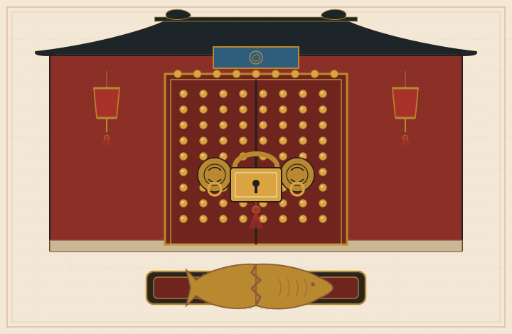

# 天枢账簿

## 一部修仙侦探小说，也是一篇区块链科普


天枢阁有九层，藏 10000 本账。

账上记着每一个修士的功德，也记着每一个修士的罪名。3000 年来，万界山门遇事不找衙门，只来这里对账。衙门会换，账房不换。账房只认一条规矩：账平。

我叫沈拾遗，天枢阁抄算弟子，15 岁。我抄了 372 页账，没有一处错漏。阁里的人叫我"小数点"。

我不讨厌这个外号。小数点不会骗人。

后来我才知道，会骗人的恰恰是账。

---

# 楔子　多出来的一笔

我 15 岁生日后的第二天，天枢阁少了一笔账。

少的不是钱。是天枢阁记在我名下的 372 笔功德。

抄算房在塔的第三层。窗纸糊了三层，风进不来，墨也干得慢。每天开工前，弟子互核昨日的账。一人念，一人对。念数的声音像雨打瓦。

阿砚念到第 372 笔，停了。

他把册子翻过去，又翻回来。耳朵尖先红起来。

"沈师兄，"他说，"你这一页，是空的。"

我抢过册子。我名下那一栏，372 笔抄账记录，四个字"无一错漏"，没了。纸面干干净净，连墨都没留一点。不是涂改。涂改有痕，我娘教过我，指甲刮过纸面会起毛。这是被人整整齐齐揭走了一层。

我脑子很静。静得能听见自己的心跳。我家三代账房，遇到坏账就是这个反应：先别怒，先算。

"不对。"我说。

万份制度下，改我这一页，等于同时改 10000 本。谁有这么大的本事？

阿砚翻出他自己的抄本。我那页功德，好端端躺在纸上，"无一错漏"四个字墨色如新。

我松了口气，只松了半口。

那我的这本为什么是空的？

答案在我准备合册的时候浮出来。页脚有一行小字，是新记的，笔迹不是我的，是账房自己的手笔：

"沈拾遗功德 372 笔，转讫。剑纹验讫。"

转讫。我的功德不是被抹掉的。是被转走的。走的是正规账，盖的是正规印，验的是正规剑纹。账房的手笔没有一丝慌乱，像给一头猪阉了之后，还替它把毛捋顺。

而那个"剑纹"，是我的。

我从怀里摸出私册。那是我自己的账，372 页，一页一页抄，一页一页盖印。我把私册浸进验墨水。

纸一入水，页脚的印浮起来，像一层薄薄的油。印是真的。

我又把公册的那页浸进去。空白的纸面上，那行"转讫"的印也浮起来。也是真的。

两枚真印，一本空账。

印是真的。账是假的。

我盯着那四个字看了很久。久到阿砚以为我傻了。

我没傻。我在想一件很不划算的事：全天下都验过了，签名是我的。我自己，把功德签给了一个陌生人。

什么时候？

> **【天枢阁·案卷】第一卷　万份制度**
>
> 案卷说破：天枢阁就是区块链。账页是区块，抄本是节点，定魂印是哈希，万份制度是共识。中本聪 2008 年的白皮书把它写成"一个点对点的电子现金系统"[1]。每个节点保存一份账本，新账广播给所有人，谁也不能单独改历史。
>
> 关键差别在"合法"两个字。区块链防的是"偷偷改"，不防"按规矩签"。钓鱼授权、私钥泄露、合约漏洞，都是按规矩把账做平。账越平，人越亏。

---

# 第一章　定魂印

醉山先生住在塔顶。

塔顶是水运仪象台。浑仪、浑象、报时木人，全阁的时间都由这台铜机器定。醉山先生把酒壶搁在浑仪的底座上，自己坐在栏杆边，脚垂在 3000 丈的空中。

"你确定那一页被人动过？"他问。

"是。"

"拿你的册子，去和祖本对。"他晃了晃酒壶，"对完再来。"

藏经阁在塔的第六层。祖本锁在一只铁函里，函盖上有九叠篆的封。墨三蹲在函前，用一把机关钥拨了三下，铁函"咔"地开了。

墨三是墨家机关师，31 岁，手上常年一层墨和铜绿。他修转轮藏，修机关鸢，修水运仪象台。他不信神仙，只信榫卯。

祖本摊开。我那一页功德，也在。

372 笔，"无一错漏"，和洛九思那本一字不差。

只有我手里这本是空的。

我抱着两本册子，坐在藏经阁的石阶上算这笔账。祖本在，各山门的抄本在，全天下都记得我有 372 笔功德。只有我这一本忘了。那我的"忘"算什么呢？

"不算什么。"墨三不知什么时候站在我背后，"账在众，不在一。"

"为什么改一页账，瞒不过 10000 本抄本？"

"因为对得上。"

"怎么对？"

"每页有定魂印。"

这是抄算弟子第一课的内容。天枢阁的每一页账，抄完之后要盖一枚定魂印。印不是刻出来的，是从账页里"长"出来的。把页上所有文字按次序喂进一套固定的算路，算出一个数。这个数就是印。同样的字，同样的次序，喂进去，出来的数永远一样。

算路装在一只印炉里。印炉是一只青铜炉，炉身铸着 64 个孔，每孔一个字。账页的竹简从炉口喂进去，炉膛里的铜珠滚过 64 道槽，最后从 64 个孔里吐出 64 个字。同样的竹简，同样的 64 个字。改一个字，64 个字全变。

我背过它的三条性子。

第一条，单向。看见印，推不回账页。就像看见一个人踩出的脚印，你推不出他今天穿了什么袜子。脚印只说明：有人来过，脚这么大。

第二条，雪崩。账页改动一个字，印就面目全非。我入门那年试过：同一页账，把"37"改成"38"，重算一遍印，出来的数和原印像两把不同的锁，没有一个位置相同。墨三当时说："记住这个脾气。定魂印不认'就改了一点'。"


第三条，抗碰撞。想找两页不同的账，盖出同一枚印，比登天还难。天枢阁 3000 年，没人找到过。

而账页之间，还有第四件事。每一页的定魂印，都要把上一页的印吞进去一起算。页与页咬成一条链，这就是链账。你想改第八页，第八页的印就变了。第九页吞过旧印，第九页也得变。一路变到最后，整条链的印全数报废。除非你把这条链从头到尾全部重盖。

```
定魂诀
料 = 前页之印 + 本页之文
印 = 印炉(料)
刻 印 于 页脚
```


"所以，"墨三自问自答，照例只把答案递到嘴边就收住，"你那一本，为什么是空的？"

我忽然坐直了。

我的册子被人整页揭走，换了一页白纸上去。白纸的定魂印是真的，白纸上的那行"转讫"也是真的。改一页，就得重盖后面所有页的印。可全阁的抄本都还记着我的 372 笔，祖本也记着。我的册子从中间断过，只要它和祖本对一次，断链就会露出来。

它没露出来。

因为那页"转讫"根本不是篡改。它是被一笔合法的新账盖过去的。我的功德被一笔一笔转走了，每一笔都验过印，每一笔都进了链，每一笔都抄送 10000 本。全天下都觉得这笔账天经地义。

只有我知道，我没签过。

"墨三，"我抬起头，"我明明没盖过印。为什么账上说是我的剑纹？"

墨三没答。他从怀里摸出一面铜镜，搁在祖本旁边。

"把你想看的两页叠在一起，照。"

我照做了。祖本上那页"转讫"，和我私册上的那页功德，在镜里叠成一张。两页的印一上一下，纹路竟然接得上。接缝处有一道极细的旧痕，像瓷器上的冲线。

我把镜面挪到祖本的开头。创世卷第一页。开山祖师的名字下面，有一行修补记，字迹很小，盖着一枚剑纹。

镜面起雾了。

我伸手擦。雾是从我袖口来的。我的手腕在抖，汗从袖口里渗出来，洇在镜面上。

那枚剑纹，我认得。

三年前，我 12 岁。母本创世卷第一页，有一笔对不上。差一文。我改了一个字，把账改平。我盖了自己的剑纹。

我以为我救了一笔账。

镜里的雾越积越厚。我听见自己的牙在磕。

那道剑纹，是我的。

> **【天枢阁·案卷】第二卷　定魂印与链账**
>
> 案卷说破：定魂印就是哈希函数。天枢阁用的是 SHA-256，由美国国家标准与技术研究院（NIST）发布，标准号 FIPS 180-4[7]。"链账"就是区块链。每个区块的头部带着上一个区块的哈希，环环相扣。改一个区块，后面全部对不上。中本聪的原始论文[1]里，这个结构叫"chain of blocks"。
>
> 雪崩效应不是修辞，是实测。把两个真实输入各算一遍 SHA-256：
>
> - "你好" → `670d9743542cae3ea7ebe36af56bd53648b0a1126162e78d81a32934a711302e`
> - "你好。" → `81fddea03ec6aa29ed52fc9b346ca130613650a71fd8d3ffc93077bc27806bc1`
>
> 只多了一个句号，64 个字符里几乎全变了。哈希算法的设计目标之一，就是让这种"牵一发动全身"成为铁律。
>
> 默克尔树是链账的兄弟结构。Ralph Merkle 在 1979 年提出，用来把"一页账"压缩成"一枚印"，让校账不必搬运整本账[33]。通俗讲解见开源书《精通比特币》[2]。

---

# 第二章　剑意账印

洛九思是第三天来的。

她 17 岁，执法堂弟子，剑穗在指间绕了一圈。她查案不问"你觉得"，只问"账上写"。

"证据呢？"

我把揭空的页子推过去。"转讫，剑纹验讫。"

她翻到页脚那行小字，又翻回我那页的抬头，眉头动了一下。"你确定你的功德被人动过，而不是你自己花的？"

"我花的每一笔，我都记得数目。"我说，"372 笔，一笔一笔，我记得。"

"记性不是证据。"洛九思把册子还我，"去问醉山先生。他要是肯见你。"

醉山先生肯见。这倒稀奇。天枢阁主一天见的人比抄算房一天抄的页多，可他见我，只问了一句：

"你确定，那一页被人动过？"

"是。"

"那就去玄山剑峰。"他说，"看完跳峰，你就知道了。"

玄山剑峰没有路。

峰顶到半山，隔着 3000 丈空。修士下山不绕路，跳。跳法有讲究：每人入门时，心中凝出一道剑意，剑意只自己知道，说不出口，写不出来。从剑意能推出一枚剑纹，剑纹刻在山门的名册上，人人可查。剑纹是公开的，剑意是死的。

"看好了。"带我们登峰的教习往崖下指了指。

一名内门弟子纵身跃下。他在半空中踩到了第一个光点。那是剑峰预设的起跳石，叫基点，万界弟子共用同一块。他从基点跳向自己的剑纹，路线只有一条：沿着山脊上那道看不见的曲线走。曲线在崖壁上显出淡淡一道银痕，像一条被风吹弯的河。

弟子每"跳"一次，落点就沿着银痕挪一段。挪多少、往哪挪，全由剑意定。跳完，他稳稳落在半山平台，朝我们拱手。

"剑纹，就是你的落点。"教习说，"从剑意推到剑纹，一路跳，谁都会。反过来，只给你落点，要你倒推他跳了几次、从哪块石头起跳。"

他想了想，找了个我们听得懂的比方。

"全修真界一起跳，跳到太阳烧尽，也推不出来。"

洛九思在旁边补了一句："这道银痕，是曲线 y² = x³ + 7。"

我愣了。二次函数我都只见过课本上的抛物线，这条弯成葫芦的曲线，居然是个方程。她见我愣，也不安慰，只把句子放慢："x 和 y 各自取数，满足左边是 y 的平方、右边是 x 的立方加 7，所有这样的点连起来，就是它。真实算账时，数不是随便取，是模一个大质数 p，像钟表一样，过了 p 点就回到 1 点。曲线绕着钟面走，走出来的点，有限，但多到数不清。"


"跳峰的规矩是：过曲线上两点画一条直线，直线与曲线必有第三个交点，把交点沿横轴翻上去，就是这两点相加的结果。"她拨了拨剑穗，"你的剑纹，就是基点自己加自己、重复跳若干次之后的落点。"

我当场心算了一遍：正向跳，跳几千次也就是几千步。倒着推，要把"跳了几次"从落点里抠出来，没有捷径，只能一次次试。p 大到 2 的 256 次方量级，试完？别试了，试了就是死。

"现在说你的案子。"洛九思把我拉回石阶上那行小字，"账上写'剑纹验讫'。签名这个东西，妙就妙在：它证明的不是'你是谁'，是'你手里有那道剑意'。别人看见签名，验得过，却抄不走。下一笔换个账页再签，旧的签名就废了。"

"所以我的功德被人转走，只有两种可能。"我接得很快，"要么我的剑意被人偷了。要么，是我自己签的。"

剑意偷不走。它凝在心里，说出来会散，写下来会化。那就只剩一种：我签过。

我花了三天，把自己这半年的行迹倒着跳了一遍。抄算房、斋堂、坊市、任务堂。我不出门，剑意不出心，我能签账的场合只有一个：盖印。

盖印的场合，半年里我只去过一次。

坊市。那天有个穿灰袍的老前辈，在摊子前替一个后生解围。后生被人缠着兑一张赏金票，缠的人说他票是假的。老前辈验了票，说是真的，顺手教后生："拿着，去账房柜上，把这张票的代取之权签给这位小哥，他替你去取，你省一趟脚程。"

后生签了。我在旁边看热闹，看得很仔细。第二天，我的赏金票也被人缠了，同样的话术，同样的老前辈。他教我："小兄弟，柜上有种签，叫代取签。你签了它，等于告诉账房：持这张签的人，可以替我取一笔。你不亏，你只是把'取'这个动作，租给别人。"

我问租给谁。他说："租给票行，票行替你跑柜。"

我签了。签的时候，柜上的先生把签文念给我听过："兹授权持签人，代取本人名下功德，数额：全数"。我听见了"全数"两个字。我当时以为，全数是指我那张赏金票的全数。

一张票的全数，和名下功德的全数。

一字之差。

"不对。"我说。

洛九思看我："你又说不对。哪里不对？"

"签文他念给我听了，我听见了。"我盯着地面，"我听见了'全数'，我以为是一笔的全数。他没骗我一个字。他只是没告诉我，'全数'后面跟的是哪个词。"

这就是那天的真相：没人偷我的剑意，没人改我的账。有人借了我的手，盖了我自己的印，把我名下功德全数转给了一个陌生账户。链上每一环都验讫，10000 本抄本都认。

账，是平的。

人才是亏的。

"等等。"洛九思忽然蹲下，从袖里摸出两块磨石，"你说你盖印只去过一次印房。印房的磨石，是谁换的？"

磨石是刻剑纹的母石。每人的剑纹刻在一块磨石上，磨石一磨，纹就定了。印房替全阁弟子磨石，磨完的母石要收进库，库房有账。

洛九思把两块磨石并排放在水盆里。水面浮出两道一模一样的纹。

"天下没有两道一样的剑纹，"她说，"除非有人懒得换石头。"

两块磨石底部，各有一个小小的"洛"字。

她的指节白了。

"我舅父开印房。"她说。

> **【天枢阁·案卷】第三卷　剑意账印**
>
> 案卷说破：剑意就是私钥，剑纹就是公钥，盖印就是数字签名。天枢阁用的这套算路，现实里叫 ECDSA 椭圆曲线数字签名算法，标准见 NIST FIPS 186-5[10]。曲线 secp256k1 的参数由 Certicom 公布[8]，基础算法见 IETF RFC 6090[9]。
>
> "正向易、反向难"有个学名，叫椭圆曲线离散对数问题：给定基点和落点，反推跳的次数，目前没有已知的高效算法。安全性就押在这句话上。
>
> 签名要用一个随机数，术语叫 nonce。同一个 nonce 签了两笔不同的账，两条签名方程一减，nonce 就露出来。nonce 露出来，私钥就能解出来。RFC 6979 规定了确定性 nonce 的生成办法，就是为了堵这个洞[31]。天枢阁的印房懒得换磨石，等于把同一个 nonce 用了两遍。
>
> 沈拾遗中的招，现实里有个名字：授权钓鱼。区块链钱包里有一类操作叫 approve。你不转币，你只是授权某个地址可以替你动一笔额度。钓鱼者把授权对象伪装成"票行"，你按下签名，资产就被"合法"转走。链上记录无错可挑，错的只在签名的人没看懂签的是什么。
>
> 天枢阁的教训，送给所有会用手机钱包的人：看不懂签名的内容，就不要按下去。

---

# 第三章　开山夺脉

钱没有丢。钱只是换了主人。

这是账房的老话。我娘查账，从来不问"钱去哪了"，只问"钱从哪走的"。顺着那笔"转讫"往回倒，收款账户是陌生的，可它取功德的地方不陌生：西边的凿山场。

墨三要去凿山场修一架水车。我替他背工具箱，混进了车队。洛九思换了身短打，跟在后头，剑穗塞进袖子里。

机关城在两道山脊之间。城墙是石头垒的，不高，墙头架着一排铜火铳，粗短，有箍，铳口朝着谷底。天亮时守军放了一铳，声音在山谷里滚了三圈，惊起一片乌鸦。

城里的水车比人多。水从高处下来，推着轮子转，轮子带着轴，轴带着齿轮，齿轮咬着另一排齿轮。墨三说，这一套叫"传动"。动力从水口传到磨坊，传到印炉，传到凿山场的钻架，中间不用一个人搬。

凿山场在城后的一面石壁下。

满山的修士人手一把灵镐，对着一面巨大的石壁凿。石壁上刻着一批待封的账目。每人凿的时候，心里默念一个数，把"账目+默念的数"一起喂进定魂印的算路，算出一枚印。印要是开头带够数目目的"空纹"，这一页就归他封，阁里发赏。

空纹就是印最前面连着好几个零。零越多，越难碰。碰上一个，算运气。碰不上，换个默念的数再碰。

"这就是凿山。"墨三蹲在水车边，拿一把小锤敲轴承，"一遍一遍试，试到印炉吐出一个带空纹的印。没有捷径。你想快，只能多派人，多买镐，多烧香。"


带几道空纹，不是自己定的。阁里有一条自动的规矩：凿山的人多了，空纹要求就加一道。人少了，就减一道。这条规矩叫调脉，让封页的节奏稳在"平均一炷香封一页"。

"一炷香。"洛九思站在我旁边，"你知道一炷香意味着什么？"

意味着快。意味着下一个封页的人，几乎是在你喘口气的工夫里就把下一页抢走了。你还想改前面那页？改了的页和你的页定魂印接不上，你后面凿得再快也接不上大流。

"所以账链只认一条。"我说。

"认最长的那条。"她把剑穗绕回指间，"满山的人，凿到哪条链最长，就都往哪条链上接。谁也别想让别人认自己的短链。"

我在崖顶数了三天人头，越数越不对。

凿山场明册上的工，是 4200 人。可我夜里蹲在山道口数火把，数出 6000 多。多出来的 2000 多人不进明册，凿出的印也不接大流，接在一条只有他们自己认的小链上。小链起初很短，短得可笑。可是它一直在长。

有人在山里养了一支影子抄手。

石壁上的孔一排一排往上排。一个孔插一炷香，香烧完，一个孔。我数到第 64 个孔时，看见孔底刻着三个字。

顾振铎。

我后颈的汗一下子凉了。

"你数得比我准。"

声音从我背后传来。灰袍，灯笼，礼数周全得让人发毛。坊市里那个替我解围的老前辈，就站在凿山场的石阶上。

"你的 372 笔，"他说，"是我取走的。"

我攥紧了袖里的私册。

"我不取，你会追到这里吗？"他把灯笼搁在地上，火苗晃了一下，"你追的是一笔钱。我追的是一页账。我们走的是一条路。"

"你到底想要什么？"

"我要这本账当众烂一次。"

他说这话时，脸上没有狠劲，也没有笑。像一个账房在说"这笔账该平了"。

30 年前，顾振铎是藏经阁执事，72 岁，那时候 42 岁。他查创世卷，发现开山祖师一人领了两份功德。同一笔 372 文，记在两个名字下。他把这件事报给了当时的阁主。

第二天，账上多了一页。那页写着：顾振铎，监守自盗，转出 372 文。印是他的。他申诉了 30 年，每一任阁主都说：查无实据。

"我没拿。"他说，"可账上记了。账上记了，我就是贼。"

"所以你养了 30 年的山。"

"我攒了 30 年的算力。"他纠正我，用词精确，"凿山这件事，人多了不算什么。可山里的脉是有限的，我买断了西边 11 条脉。你们封一页的工夫，我的影子能封三页。迟早。"

"你超不过。"我说，"阁里有调脉。人多了，空纹就加。"

"调脉加的是空纹，不是人心。"他笑了笑，"你们 4200 人，来自 108 个山门。108 个山门，108 本账。谁肯把自己的账并给别人的链？你们凿得再快，也快不过一条只认一个人的链。"

我站在原地，把这笔账在心里过了一遍。他说的"迟早"，算术上真的成立。影子链每刻都比大链快一点点，快一点点攒上 30 年，就会在某一刻突然反超。

反超那天，全天下 10000 本抄本会一起改口。

"你告诉我这些，"我说，"不怕我告你？"

"我怕你不告。"他提起灯笼，"你告了，阁里才会开终局殿。开了终局殿，才会有人去看创世卷。"

他走了两步，又回头。

"小兄弟，你三年前改的那个字，改得真好。账平了。"

我的耳朵里"嗡"的一声。


> **【天枢阁·案卷】第四卷　开山夺脉**
>
> 案卷说破：凿山封页就是挖矿，抢着给账本盖章的机制叫工作量证明（Proof of Work，PoW）。比特币用的就是它，原始论文见中本聪 2008 年[1]。
>
> 机制拆开只有四步：第一，把待确认的账目和一个随机数喂进 SHA-256。第二，要求输出的哈希开头有足够多个零。第三，随机数只能一个个试，没有捷径，试得快全靠机器多。第四，谁先试中谁打包这个区块，拿走区块奖励。调脉对应比特币的难度调整：每 2016 个区块按实际出块速度自动校准，目标稳在约 10 分钟一个区块。
>
> 最长链为真就是中本聪共识。它带来两个后果：双花，同一笔钱在两条链上各花一次。51% 攻击，算力过半者可以重写近期账。顾振铎买断 11 条脉，对应的就是矿池集中化风险。
>
> 数字（截至 2026 年 10 月）：比特币全网算力约 1.08 ZH/s，也就是每秒约 10 的 21 次方次哈希[27]。年耗电约 138 TWh，口径来自剑桥大学替代金融中心 2025 年 4 月报告[24]。区块奖励现为 3.125 BTC，由 2024 年 4 月的第 4 次减半而来，总量封顶 2100 万枚。
>
> 凿山也确实养活了现实里一整条产业链：矿机、矿场、水电站。这不是段子，是产业。

---

# 第四章　论功行签

影子链反超的第二天，天枢阁炸了。

不是为我的功德。372 笔功德，账链一翻面，又"转讫"回了顾振铎指定的账户，大链重新为真，我的钱第二次没了。我是为这个炸的。

阁老们炸的是另一件事：凿山场太慢，慢到一条养了 30 年的影子链能一口气攒出反超的力气。

"改制度。"醉山先生把酒壶往案上一放，"从今往后，封页不凿山了。论功行签。"

新规矩是这样的：想负责封页，先押修为。押得越多，名字在签筒里越沉，被抽中的机会越大。抽中的人封页，封完领赏。要是他敢封一页假账，或者同时往两条链上押注，押的修为当场废掉一半，名字踢出签筒。这一手叫削功。

"凿山废的是电，行签废的是身家。"洛九思给我解释，"作恶的成本从电费变成了本金。本金会疼，电费不会。"

我问先生："押修为的人要是串通呢？100 个人把修为都押给一个签筒，他抽中 10 次，九次封假账，一次封真账。"

"你猜天下人怎么防？"先生又只反问。

我自己想了三天，想出来一半：假账页会被别的封页人拒收，拒收他就领不到赏，领不到赏他的本金还在流血。可另一半我没想出来：要是假账页已经被人收了呢？链都接上了呢？

答案在一个月后自己送上门。

阁里封页，每 64 页设一道终局检查点。检查点不是盖章，是表决：全天下有签的人对"前 64 页认不认"投两轮。第一轮过半，进入候选。第二轮集齐三分之二，落锁。落锁的页，从此不许任何链再翻。谁想翻？行，把支持旧页的押注全烧掉，还要在另一条链上凑出三分之二的签。全修真界的修为，凑不出这个数。

墨三把两种劫的差别写在纸上，贴在印炉旁边。字很丑，数很准。

| 项目 | 凿山劫（PoW） | 行签劫（PoS） |
|---|---|---|
| 凭据 | 算力，电一停就没了 | 本金，押进去才作数 |
| 作恶代价 | 白烧电，机器还在 | 罚没质押，本金当场少一半 |
| 终局 | 最长链，等 6 个区块才敢说稳 | 两轮表决，检查点落锁 |
| 能耗 | 高，全网一起烧 | 低，只有验证节点在跑 |
| 现实对应 | 比特币 | 以太坊 |



顾振铎就是撞在这道锁上死的。

他不知道阁里改了制度。影子链还在凿，凿到反超那天，他往旧链上压上了 30 年的算力，把"监守自盗"抹掉的那一页，一度成了最长链。可最长链规则在新制度上不再通吃。新链每 64 页落一次终局锁，他的影子链永远短一截，永远落不了锁。落不了锁的账，是浮账。浮账改不了已经落锁的旧账。

30 年，11 条脉，2317 个影子抄手。输给了"三分之二"这一道锁。

终局殿在塔的第五层。殿中央摆着一只铜匦，签从匦口投进去，唱签人一签一签往外唱。108 个山门，108 枚签。签上刻着山门的名字，签尾挂着押注的重量。重量不一样，唱出来的声音就不一样。轻的签像落叶，重的签像铁块砸在铜板上。

我站在殿角的帘子后面，替执法堂记数。

唱到第 73 枚，洛九思的刀出鞘了半寸。

那枚签上刻着一个"洛"字。洛氏印房，押注 30 万功德，是全场第三重的一枚。唱签人念出签尾的委托名，殿里静了一瞬。

36 家上院，把票全委托给了同一个人。

那个人不在殿里。他的名字写在一张纸上，纸压在铜匦底下，谁也没见过他的脸。

洛九思的刀又推回鞘里。她的手指在刀柄上停了很久。

"36 家，投了同一个人。"她低声说，"这不是终局。这是分赃。"

顾振铎在凿山场被收的时候，没有跑。他坐在山道口的石头上，灯笼搁在脚边，很守时地等他们。

"我算过。"他对洛九思说，"我比你们快。"

"你快。"洛九思说，"可你不重。"

我站在后面听明白了。凿山比的是谁快，行签比的是谁沉。快的可以攒，沉的骗不来。

顾振铎被押走时，回头看了我一眼。那一眼不狠，也不求。像在说：你看，账平了。

> **【天枢阁·案卷】第五卷　论功行签**
>
> 案卷说破：押修为封页就是权益证明（Proof of Stake，PoS）。以太坊 2022 年 9 月 15 日完成"合并"，改用这套机制，能耗下降约 99.95%，数据见以太坊基金会官网[4]。
>
> 削功对应 slashing。验证者对同一高度出两个互相冲突的区块，或者在不该表态时表态，质押的 ETH 会被罚没。终局检查点对应 Casper FFG：每 32 个 epoch 做一次两轮表决，epoch 约 6.4 分钟，第二轮集齐三分之二权重就给区块加检查点。加过检查点的历史，在正常条件下不可翻转。协议细节见 Buterin 与 Griffith 的 Casper 论文[5]与 Gasper 论文[6]。
>
> 数字（截至 2026 年 10 月）：以太坊活跃验证者约 97 万，质押约 3100 万 ETH[28]。
>
> 值得记一笔的是：PoS 的终局性是经济安全加协议规则的组合，不是数学定理。理论上烧掉足够多的本金仍能翻转历史，只是代价高到没人付得起。顾振铎输就输在，他攒的是算力，而新规矩罚的是本金。
>
> 另一种风险叫治理捕获。36 家把票委托给同一个人，听起来像效率，实际是把三分之二的闸门交给了一把钥匙。协议能防伪造，防不了合谋。

---

# 第五章　万叉一会

顾振铎被收进大牢之后，天枢阁没有安静下来。反而更吵了。

原因很简单。影子链的事捅穿了，所有人都看明白一件事：阁里的账，慢。一笔新账，从落笔到封页抄送，平均要一刻钟。一刻钟，够一笔功德转手几十遍。影子链攒了 30 年才反超一次，靠的就是这份慢。慢，是给贼留门。

醉山先生开了阁门，十年一届的万叉一会提前了。上一回开这个会，是 3000 年前焚库之乱之后，会上定了万份制度。这一回，议题只有一个：快。

我被派去记录。记录是苦差，可记录也是满堂唯一一个能听所有人说话的位置。我带了三枝笔一沓白纸，记的不是话，是数：每个方案从落笔到账成，要几息。

第一个方案来自灭香岭。

上台的人捧着一炷香。香很细，很直，往堂中间一插，点燃。

"账慢，慢的不是手，是嘴。"他说，"新账来了，10000 本抄本要互相传话：这笔先到，那笔后到。传过来传过去，一刻钟就传没了。为什么要传？时辰自己会说话。"

他指着那炷香。我这回看清了。香烧出来的每一粒香灰，都是拿上一粒灰算出来的，算路就是定魂印。灰的数目环环相扣，谁也伪造不了，谁也倒着改不了。

"新账落笔，就盖上当前这粒灰的数目。"他说，"谁先谁后，不用吵。看灰。灰就是次序。"

堂下有人问："香炉在他手里。他把香掐灭，重烧一炉呢？"

"灰纹公开，10000 本抄本都盯着香炉。"他早有准备，"香灭一息，灰纹就断。断了的灰，接不上大流。"

第二个方案来自万木林。

台上没有香，只有一棵树。树上挂着 1000 片叶子，每片叶子写着一笔账。树下站着一排人，每人手里一根绳，绳连着树上的枝。

"账不必排成一条线。"那人说，"一笔账和另一笔账，只要不打架，就能同时办。你转给甲，我转给乙，两笔账互不相干，为什么要排队？让它们各走各的枝，最后在树根汇合。"

他拽了一根绳。树上的叶子抖了一下，两片叶子同时落下，落进树根下的两只筐里。筐上各有一枚印，印纹一合，成了根印。

"这叫有向无环。"他说，"没有回头路，所以不怕乱。枝再多，根只有一个。"

第三个方案来自都江堰。

台上摆着一座水槽。水槽从高处下来，到中途分成 12 条支渠。每条支渠口有一道闸，闸上写着不同的山门名。

"账慢，是因为所有人都抢同一个水口。"那人说，"把水口分开。12 条支渠，12 个山门各管一段。你走你的渠，我走我的渠。汇到下游，再合成一条大河。"

他开闸。水哗地涌进支渠，12 条渠同时满了。堂下叫好。

然后水停了。

不是慢慢停的。是"咔"的一声，全停了。12 条支渠的下游，汇在一个窄口上。窄口塞着一块石头。上游的水越多，堵得越死。


顾振铎站在看台上。

他戴着镣铐，镣铐上缠着红布，是执法堂给老人留的体面。他鼓了三下掌。

"你们比我快。"他说，"可你们还是得排队。"

满堂静了。

"香要一炷一炷烧。树要一根一根拽。水要一渠一渠汇。"他抬起镣铐，铁链哗啦一响，"你们把慢的地方切成了 12 块，可 12 块还是要在一个口子上碰头。碰头就要排队。排队就要有人定次序。定次序的人，就是你们的新账房。"

他转过头，看着醉山先生。

"你们换了三把刀，刀刀都快。可你们不敢碰那页账。"

醉山先生把酒壶放下。

"哪一页？"

"创世卷，第一页。"顾振铎说，"372 文，记了两遍。你们 108 个山门，拜了 3000 年的开山祖师，是个贼。"

殿里有人拍案而起。有人拔剑。有人往后退。

顾振铎不躲。他把镣铐搁在栏杆上，像搁一副不合手的算盘。

"我今天不跑。"他说，"我拿我那条影子链的创世页做彩头。你们开母本。开了，当众对。对得上，我认罪，影子链烧给你。对不上，你们烧我。"

醉山先生看着我。

那一眼很长。长到我听见殿外的风把檐角的铜铃吹响了三次。

"沈拾遗。"他说，"你算账快。你去。"

> **【天枢阁·案卷】第六卷　万叉一会**
>
> 案卷说破：三个方案对应现实里三条提速路线。
>
> 灭香岭是 Solana 的历史证明（Proof of History，PoH）。它用一串连续哈希给事件盖时间戳，像一炷香烧出的灰，谁也无法倒着改。PoH 本身不是共识，它是一只公共时钟，共识靠 Tower BFT。白皮书见 Yakovenko 2018[11]。
>
> 万木林是有向无环图（DAG）。Sui 的 Mysticeti、Aptos 的 Bullshark 都把交易先排成图，再让验证者投票定序。论文见 Babel 等 2023[13]与 Danezis 等 2021[12]。
>
> 都江堰是并行执行。Sui 按"对象"切分交易，互不相干的对象可以同时执行。Conflux 用树图结构，让并发出块最终收敛到一条主链。论文见 Li 等 2018[14]。
>
> 三条路线都在回答同一个问题：如何让更多交易同时进行，又不让账分成两本。答案不是"取消排队"，是"把排队切细，再用更重的共识把队尾焊死"。
>
> 这就是不可能三角：去中心化、安全、速度，三者不能同时拉满。谁说自己三样都满分，谁在偷换定义。
>
> 数字（截至 2026 年 10 月）：Solana 官方标称峰值 65000 TPS，第三方实测常见 1000 到 3000 TPS[29]。Sui 官方测试峰值十余万 TPS，主网常见数百到数千。Conflux 官方标称 3000 到 6000 TPS。口径不同，别拿峰值当日常。

---

# 第六章　心魔法阵

赌约法阵立在机关城的地宫里。

那是一块八角石盘，盘面刻着 64 圈阵纹，圈与圈之间用铜线连着。阵眼是一枚拳头大的灵石，灵气从石眼里渗出来，沿着铜线走，走一圈，阵纹亮一格。亮完 64 格，一阵事就办完了。

法阵的 64 圈阵纹，让我想起塔心的转轮藏。那座八角经柜有 108 个经匣，一匣一山门，一匣一份账。柜子转一格，108 份抄本同时换一页。墨三说，转轮藏是死的，法阵是活的。死柜子只会转，活法阵会算。


墨三叫它"会自己算账的阵"。

"你把契文写进阵里，阵就照着办。"他蹲在石盘边，拿一把小刷子扫铜线里的灰，"该给谁多少，什么条件下给，办完写在哪，全由契文定。人不用守着。守着的只有灵气。"

"灵气是什么？"

"阵的饭。"墨三说，"每亮一格，吃一口灵气。吃完了，阵就停。停了的阵，前面亮的格子全灭，账一笔不算。这叫 atomic，要么全成，要么全不成。"

我想起抄算房的规矩：一页账，写到一半断了墨，整页作废，不能半页入链。法阵比抄算房严。抄算房废一页，纸还在。法阵废一阵，灵气烧掉，连灰都不剩。

我要立一个赌约。

契文很简单：我把追回来的 372 笔功德押进阵眼，谁能在阵里拿出一枚"创世页伪账"的证明，372 笔全归谁。拿不出，功德退回。这个阵替我看钱，也替我钓鱼。顾振铎想要账烂，就得来拿这笔钱。他来拿，就得留下脚印。

墨三看完契文，没说话。他把铜线重新接了一遍，又在阵眼旁边加了一个小格。

"这个格叫传音。"他说，"阵办事的时候，可以呼叫外面的阵。你留着，万一要喊人。"

"有必要吗？"

"阵是死的。人是活的。"他把刷子往腰里一别，"死的东西，最怕活人绕路。"

我把契文喂进阵眼。灵气一亮，阵纹从中心往外一圈一圈亮起来，像一朵慢慢开的铜花。372 笔功德落进阵眼，阵眼里多了一团白气。

第三天，有人来拿钱了。

来的是一个没有脸的影子。它站在阵外，递进来一枚印。印一验，是真的。印上写着：创世卷第一页，372 文，记了两遍。

阵认了。

阵眼吐出一口气，372 笔功德从阵眼里流出来，流向影子的账户。流到一半，影子没有走。它伸出手，在阵边的传音格里按了一下。

阵响了。

"取回。"影子说。

阵的契文里有一条"取回"的格子。押功德的人，随时可以把没花完的功德取回去。影子按了传音，阵就以为押功德的人来了。阵把剩下的功德又吐了一遍。

影子再按。

阵再吐。

一遍，两遍，三遍。阵眼里的白气越来越薄，铜线越来越烫。墨三从地宫门口冲进来，一把拽住我的手。

"停阵！"

"怎么停？"

"停不了。"他的脸白了，"阵在办契文。契文没写完，阵不听人。"

我这才看清阵纹的走向。影子每按一次传音，阵就回到"取回"那一格。回到那一格，阵先吐钱，后销账。钱吐出去了，账还没来得及销，传音又来了。阵看见的账，永远是旧的。

先付钱，后销账。

六个字，把一座阵抽干了。


最后一缕灵气从阵眼里退出来，像退潮。铜线一根一根暗下去。372 笔功德，一笔不剩。

阵停了。

我蹲在石盘边，看着空空的阵眼，胃里泛酸。

"账平了。"墨三说。

"钱少了。"我说。

影子走了，脚印留下来了。阵虽然停了，阵里的账页还在。每一笔流出去的功德，都带着一个来路。我顺着来路倒，倒到第一笔，看见一个熟悉的印。

创世卷第一页的印。

那枚印的 64 个字，我一个一个认。认到最后，我的手指头凉了。

那 64 个字里，有一个字，是我三年前改的。

> **【天枢阁·案卷】第七卷　心魔法阵**
>
> 案卷说破：赌约法阵就是智能合约。契文是字节码，阵眼是状态，灵气是 gas。智能合约跑在虚拟机上。以太坊的虚拟机叫 EVM，黄皮书见 Wood 2025 版[16]。
>
> 一笔转账的完整流程有五步。第一，签名。你用私钥签一笔交易，写明收款人、金额、gas 上限[18]。第二，广播。交易被送到内存池，等着打包。第三，打包。验证者挑交易，按 gas 价格排序。第四，执行。EVM 逐条跑字节码，每跑一条扣一点 gas。第五，落账。执行结果写进状态树，等终局检查点落锁。任何一步失败，整笔交易回滚，gas 照扣。
>
> 重入攻击的根子在"先付钱，后销账"。合约调用外部地址，外部地址在钱到账后、账还没销的时候，再回调合约的取款函数。合约看见的余额还是旧的，于是再付一次。2016 年 The DAO 就是这样丢了约 360 万 ETH，最终导致以太坊硬分叉[26][32]。Solidity 的官方文档至今把"检查、生效、交互"列为防重入的顺序。
>
> 现实里的 gas 有价格，也有上限。EIP-1559 把手续费分成基础费和优先费，基础费烧掉，优先费给打包人[17]。法阵的灵气只进不出，现实里的 gas 有一部分直接销毁。两者都在做同一件事：让计算有代价。

---

# 第七章　证链

藏经洞在塔基下面。

石阶往下走 108 级，越走越冷。洞壁上有石渠，水从渠里过，声音很细，像有人在隔壁翻纸。洞底是一只金匮，匮上九道锁，锁眼里灌了铅。金匮里放着母本，天枢阁所有账的源头。

我进不去金匮。我只需要看金匮外面的"根印"。

根印刻在洞底的一块青石上，64 个字，是母本所有页的定魂印再算一遍的结果。母本每添一页，根印就变一次。根印不变，母本就没动过。

我手里有一枚鱼符。鱼符一剖为二，一半留在藏经洞，一半在执法堂。两半合拢，能验根印。这是给外门弟子查账用的"轻抄本"：你不必搬 10000 本账，只要拿一枚鱼符，验一条从页到根的印路。

墨三教过我印路怎么走。

母本的页，两两成对，算出一枚父印。父印再两两成对，算出祖父印。一路往上，算到最后一枚，就是根印。要看某一页在不在母本里，不必把整棵树搬来。你只要那一页，加上它沿途的兄弟页的印。兄弟页的印一共有多少枚？10000 页的树，高约 14 层。14 枚印，就是一条印路。


我把鱼符插进青石的槽里。鱼符亮了一条金线，从青石往上爬，爬过 14 层，爬到塔顶的一片贝叶上。

那片贝叶，是创世卷第一页。

金线在叶脉上停了一瞬，然后往回走。每走一层，青石上就多亮一枚印。14 枚印亮完，根印"咔"地一转，吐出一行字：

"此页与根印不符。"

我盯着那行字，胃里那口酸又涌上来。

不符。母本被人动过。动过的页不止一页。我把鱼符拔出来，换一片叶子，再插。第二片，不符。第三片，不符。

三片叶子，全在创世卷。

我跪在石渠边，吐了。

吐完，我用袖子擦嘴，接着算。三片叶子的改动日期，都指向同一天。三年前的秋天。我 12 岁。

第一片叶子的改动，是我改的那个字。第二片叶子的改动，是把 372 文记了两遍的那一行抹平。第三片叶子的改动，是把一行"修补记"盖在我的剑纹下面。

三页账，一笔勾销。

顾振铎的清白，就压在这三页下面。三年前，我为了把账改平，把唯一能证明他清白的证据，改没了。

我坐在洞底，听见石渠里的水一直在流。

还有一件事没算完。我的 372 笔功德，是哪儿来的？

我翻私册。三年前，我改完那页账的第二天，账上多了一笔"义学津贴"，372 文。发津贴的人是阁主。我当时高兴了三天。我以为是我抄账抄得好，阁里赏的。

372 文。创世卷里那笔被记了两遍的功德，也是 372 文。

一分不差。

我娘说过，账房里没有巧合。巧合是账没算完。

那笔钱不是赏。是封口费。我改平了账，阁里给了我 372 文，买我闭嘴。我收了钱，还替他们盖了印。

我抱着私册，在藏经洞里坐到天亮。

> **【天枢阁·案卷】第八卷　证链**
>
> 案卷说破：根印就是默克尔树根。默克尔树把一堆数据两两哈希，层层向上，最后得到一个根哈希。任何一片叶子改了，根哈希就变。要证明某片叶子在树里，不必交出整棵树，只要交出从叶子到根的路径上的兄弟哈希。验证者一路算上去，算出的根对得上，叶子就是真的。
>
> 路径长度是 log2(n)。10000 页的树，约 14 步。100 万页的树，约 20 步。账本越大，轻客户端越划算。这就是"轻"的含义：不保存全账，只保存根印，按需验路。
>
> 比特币的轻客户端用同样的办法验证交易是否在区块里。以太坊的默克尔帕特里夏树把账户、余额、代码、存储都压进一棵树，状态根写在区块头里[19]。你不必信任任何一个节点，只要信任根印和数学。
>
> 但根印只证明"这页在树里"，不证明"这页是真的"。叶子可以是假的，只要所有人都同意把它写进树。默克尔树保证的是一致性，不是真实性。沈拾遗在洞底算出的三页，证明的是母本被改过，不是母本该写什么。

---

# 第八章　问心魔劫

问心魔劫在塔的第九层。

那一层没有窗，只有一扇黑门。门高九丈，门上钉着 81 枚铜钉，门缝里透出一线光。门前立着一面铜镜，镜面很大，能照见一个人的全身。

36 家上院的掌门坐在门后。他们看不见彼此，只能看见镜面上的光。

这就是问心魔劫的规矩：证明的人站在门外，把要证的事喂进镜子。镜子只吐一个字，是，或者否。门后的人看不见证明的内容，只能看见结果。36 家各怀心法，谁也不想把自己的底牌摊在桌上。问心魔劫就是为这种场合造的。

我要证的是一件很简单的事：创世卷第一页，372 文，记了两遍。

我不能说出 372 文记在谁名下。我也不能说那两笔钱后来去了哪里。那些名字牵涉 36 家的祖师，牵涉 3000 年的香火。说出来，天枢阁当场散伙。

我只能证明"有一笔钱，记了两遍"，不证明"这笔钱是谁的"。

这就是零知识证明要干的事。

墨三帮我把证词写进阵盘。阵盘是一块巴掌大的玉，玉面上刻着 64 圈细纹。证词里有一句"我知道创世卷第一页的两个名字，也知道那 372 文的来路"。这句话不能给任何人看。阵盘把它锁进玉里，只吐出一枚印。

印落在铜镜上。

铜镜亮了。

镜面先是一片白。白里浮出两个模糊的影子，一个在左，一个在右。两个影子中间，是一枚 372 文的功德印。印只有一枚，影子却有两个。镜子把两个影子叠在一起，印没有消，反而更亮。

门后有人吸了一口气。

铜镜吐出一个字："是。"

殿里静了很久。

久到我以为门后的人都走了。

然后有人笑了一声。不是高兴的笑，是那种账房看见坏账、又不想认账的笑。

"证明过了。"一个声音说，"可这能说明什么？3000 年前的一笔旧账，也许是抄写错了，也许是重复记账，也许是祖师当年就改过。你拿一个'是'字，要我们 36 家认自己的祖师是贼？"

"证据在这里。"我说。

"证据在镜子里。"那声音说，"镜子只吐一个字。字后面是什么，我们看不见。"

"你们可以看。"

"看了，就得办。"那声音慢下来，"办了，天枢阁就散了。散了，外面那些山门找谁对账？找谁押修为？找谁封页？小兄弟，你算过这笔账吗？"

我算过。我算了一路。可我算不出答案。

顾振铎站在我身后。他戴着镣铐，镣铐上的红布褪了色。

"你们不是不信。"他说，"你们是不敢信。"

没人接话。

"我 30 年前就站在这里。"顾振铎说，"那时候门后也是 36 家。他们听了我的话，第二天，账上多了一页'监守自盗'。今天你们听见一个'是'字，明天账上会多什么？"

门后有人站了起来。椅子腿刮着石板，声音很刺。

"顾振铎，"那声音说，"你要平反，我们给你平反。372 文还你，罪名销了，你回藏经阁。够不够？"

顾振铎笑了。

"我不要平反。"他说，"平反是你们把账改一次。改一次，账还是你们的。我要它烂在那儿。烂给所有人看。"


后来墨三给我补了一页纸，上面列着两种证明法的长短。我把那页纸夹在私册里。

| 项目 | SNARK | STARK |
|---|---|---|
| 证明大小 | 几百字节，塞进鱼符还有余 | 几十到几百 KB，得用机关鸢驮 |
| 生成成本 | 较低 | 较高 |
| 验证成本 | 极低，一枚印的事 | 低，但比 SNARK 慢 |
| 可信设置 | 多半需要，设置时的秘密要销毁 | 不需要，随机公开参数即可 |
| 抗量子 | 多数不抗 | 有基础 |
| 代表 | Groth16[21] | zk-STARK[22] |

> **【天枢阁·案卷】第九卷　问心魔劫**
>
> 案卷说破：问心魔劫就是零知识证明。证明者要向验证者证明"我知道一个秘密"，却不泄露秘密本身。铜镜只吐"是"或"否"，门后的人看不见证词。
>
> 零知识证明有三个性质。完整性：真话能证明。可靠性：假话证不成立。零知识：除了"这话是真的"，验证者什么都得不到[35]。
>
> 主流的两种做法是 SNARK 与 STARK。SNARK 的证明小，验证快，但多半需要一个可信设置，设置时的秘密如果没销毁，证明者可以造假。STARK 不需要可信设置，证明大一些，验证慢一些，抗量子攻击的底子更好。Groth16 是 SNARK 的代表[21]，ZK-STARK 的原始论文见 Ben-Sasson 等 2018[22]。
>
> 零知识证明最容易被低估的用处不是隐私，是压缩。一笔复杂计算，证明者算一遍，生成一枚很小的证明。验证者只看证明，不必重算。以太坊的 ZK rollup 把上千笔交易压成一枚证明，主链只验证明，不逐笔执行。验证成本从"按交易量增长"变成"按证明数增长"。这就是验证性能的根本提升。
>
> 数字（截至 2026 年 10 月）：以太坊 L2 锁仓价值约 455 亿美元，数据来自 L2BEAT[23]。这个数字天天变，看之前先看日期。
>
> 需要说明的是：零知识证明能证明"计算是对的"，不能证明"前提是真的"。如果写进电路的前提是一页假账，证明出来的还是一个"是"字。数学不负责替人选前提。

---

# 第九章　万界共阵

醉山先生在塔顶等我。

浑仪还在转。铜球、铜环、铜水轮，一层咬一层，把天上的星次和人间的时辰对在一起。他把酒壶搁在浑仪的底座上，自己坐在栏杆边，脚垂在 3000 丈的空中。

"坐。"他说。

我坐下。风从塔顶过，把他的袖子吹得鼓起来。

"你知道天枢阁为什么能立 3000 年？"他问。

"因为账平。"

"账平靠什么？"

"靠印。靠链。靠 10000 本抄本互相盯着。"

"还靠一样东西。"他把酒壶翻过来，壶底朝天，"靠一把钥匙。"

壶底刻着 64 个篆字。字很小，笔画很细，像一群蚂蚁在壶底排队。

我凑近看。

```
天地玄黄　宇宙洪荒　日月盈昃　辰宿列张
寒来暑往　秋收冬藏　闰余成岁　律吕调阳
云腾致雨　露结为霜　金生丽水　玉出昆冈
剑号巨阙　珠称夜光　果珍李柰　菜重芥姜
```

64 个字。我认得。这是蒙学课本里的《千字文》，开头的 64 句。

"这不是钥匙。"我说。

"这是钥匙的皮。"醉山先生说，"64 个字，每个字取四位，合起来 256 位。256 位，就是金匮的锁芯。你把它们念一遍，金匮就开。"

"你为什么把它刻在酒壶上？"

"因为酒壶我天天带着。"他笑了笑，"钥匙放在保险的地方，人就会忘记。放在酒壶上，我每天喝酒，每天看见它。看见了，就想起自己是个看门的。"

他把酒壶递给我。

"你念一遍，这阁就归你。"

我接过酒壶。壶底的字被酒浸得发亮。我张了张嘴，没念。

"念了，就能改创世卷。"他说，"改了，顾振铎就清白了。你也能把 372 文还回去。账平了，你也平了。"

"你为什么给我？"

"因为你是唯一一个会算这笔账的人。"他把酒喝完，把壶底朝我晃了晃，"也因为我不想再看了。这把钥匙在我手里 30 年，我每天都能改，每天都没改。你知道每天都能改、每天都不改，是什么滋味吗？"

我不知道。

"像嘴里含着一块烧红的炭。"他说，"咽不下去，吐不出来。"

我低头看壶底。64 个字，一个字一个字地看。看到"剑号巨阙"的"剑"字，我想起剑峰的银痕。看到"玉出昆冈"的"玉"字，我想起问心魔劫的玉盘。这把钥匙不是一把铜钥匙。它是一段话。一段谁都能背、谁都能验、谁都能抄的话。

"这把钥匙，多少人知道？"

"我，你，还有壶。"他说，"壶不会说。"

我伸手去拿壶。

一只手从旁边伸过来，攥住我的手腕。

顾振铎。

他不知道什么时候上了塔顶。镣铐还在，红布没了。他的手很瘦，力气很大。

"你不能改。"他说。

"为什么？"

"你改了它，我这 30 年就成了一个可以改的错。"他盯着我，"一个可以改的错，不叫错。叫误会。误会可以原谅，可以销账，可以一笔勾销。我要的不是这个。"

"你要什么？"

"我要它烂在那儿。"他说，"烂给所有人看。3000 年的账，第一页就是假的。你们可以修，可以补，可以当没看见。可只要有一页留着，就有人会问：还有多少页是假的？"

醉山先生靠在栏杆上，看着我们两个。

"三把钥匙。"他说，"你们看见了几把？"

我愣了。

"天枢阁有三把钥匙。"他伸出一根手指，"第一把，鱼符。一剖为二，两半合拢才作数。这是万份制度，是共识。108 个山门，少一个都开不了门。"

他伸出第二根手指。

"第二把，机关钥。墨家造的铜钥匙，齿在里头，外人看不见。这是可信执行环境。你把账交给一只黑盒，黑盒说办完了，你就信它办完了。你信的不是账，是造黑盒的人。"

他伸出第三根手指。

"第三把，玉圭。问心魔劫的玉盘。这是零知识证明。你不必打开黑盒，也不必相信造盒的人。你只看一枚印，印对了，事就是对的。"

他把三根手指收回去。

"三把钥匙，三种信法。信众人，信黑盒，信数学。"他看着我，"你信哪个？"

"我信账。"我说。

"账是结果。"他说，"账后面总得有个东西。"

顾振铎松开了我的手腕。

"你念吧。"他说，"念完了，你自己选。"

我看着壶底的 64 个字。风从塔顶过，浑仪的水轮"咕噜"响了一声。

我念了。

天地玄黄，宇宙洪荒，日月盈昃，辰宿列张。

念到"剑号巨阙"的时候，塔基下面传来一声闷响。金匮的九道锁，一道一道开了。

念到"菜重芥姜"的时候，整座塔轻轻震了一下。

醉山先生把酒壶拿回去，翻正，搁在栏杆上。

"开了。"他说，"现在你可以下去改账了。"


> **【天枢阁·案卷】第十卷　万界共阵**
>
> 案卷说破：三把钥匙对应三种信任机器。
>
> 鱼符是共识。它把信任分散给 108 个山门。任何一方想作假，都得同时骗过三分之二。代价是慢，是排队，是治理可能被合谋捕获。
>
> 机关钥是可信执行环境（TEE）。英特尔 SGX、AMD SEV、ARM TrustZone 都在做这件事：在处理器里划一块黑盒，代码进去，密钥进去，出来只给一个签名证明。远程认证（attestation）让外部相信"这段代码确实在黑盒里跑过"。问题是，黑盒是厂商造的。厂商的固件有漏洞，侧信道能撬开盒子，认证链的根在厂商手里。你信的不是数学，是英特尔[34]。
>
> 玉圭是零知识证明。它把信任交给数学。证明者算一遍，验证者只看一枚小证明。没有厂商，没有黑盒，没有三分之二。代价是证明生成慢，电路写起来难，前提错了照样证出一个"是"。
>
> 现实里的系统经常三把钥匙一起用。Rollup 用零知识证明压缩计算，用共识合约锁定资产，用 TEE 加速证明生成。信任没有消失，它被拆成几份，放在不同的地方。
>
> 数字（截至 2026 年 10 月）：全球稳定币市值约 3030 亿美元，数据来自 DeFiLlama[30]。这些币的发行、赎回、储备证明，正在把"信任"拆成审计、托管、链上储备证明几件事。拆得越细，越需要一把能验的钥匙。
>
> 还有一件常被忽略的事：钥匙会丢。2025 年，英国一位男子把存有约 7.5 亿美元比特币的硬盘扔进了垃圾场，法院拒绝他挖开垃圾场[25]。链上账还在，钥匙没了。账改不了，人也进不去。

---

# 第十章　代价

金匮开的时候，藏经洞里的水停了。

石渠里的水本来一直在流。九道锁一开，水声断了，洞底静得能听见火把烧灯芯的"噼啪"。

36 家上院的掌门站在洞底。108 个山门的掌事站在他们后面。洛九思带着执法堂，站在金匮两侧。顾振铎站在火把底下。我站在金匮前面。

金匮是一只铜柜，高三尺，宽五尺，柜面铸着九叠篆的"天枢"二字。柜门开着，里面是一函贝叶经。贝叶经的第一页，就是创世卷。

醉山先生提着酒壶，走到柜前。

"今天只办一件事。"他说，"这柜里是母本。这壶底是钥匙。两样东西，只能留一样。"

"阁主。"一位上院掌门上前一步，"母本是天枢阁的根。烧了它，10000 本抄本找谁对？"

"找你们自己。"醉山先生说，"你们不是每人一本吗？"

"可根印..."

"根印在你们手里。"醉山先生说，"10000 本抄本，10000 枚根印。少了我这一本，账还是账。"

他把酒壶举起来。

"钥匙在我手里 30 年。30 年里，我每天都在想，要不要改。改了，顾振铎清白，创世卷干净，天枢阁还是天枢阁。可我改了，这本账就又多了一个能改它的人。今天是我，明天是谁？后天是谁？"

没人说话。

"账要让人信，就得让人知道：谁也不能改。"他把酒壶往火把上一倾，"包括我。"

酒泼在贝叶经上。火"轰"地窜起来。

贝叶经卷曲，发黑，一片一片往下掉。铜匮被火烧得"嗡嗡"响。醉山先生把酒壶扔进火里。壶底的 64 个篆字在火里亮了一下，然后化了。

顾振铎站在火边，没有笑。

"你烧了它，"他说，"我这辈子就真是贼了。"

"是。"醉山先生说。

"你烧了它，账就再也改不了了。"

"是。"

"你烧了它，沈拾遗的 372 文，也还不回去了。"

"是。"

顾振铎看着火，看了很久。

"好。"他说，"这样好。"


火灭的时候，金匮只剩一只铜壳。贝叶经成了灰。酒壶成了一块铜疙瘩。

洛九思走到我面前。

"沈拾遗。"她说。

"在。"

"三年前，你改了母本创世卷第一页。你盖了自己的剑纹。你收了 372 文义学津贴。"她把三张拓片摊在我面前，"印是真的。账是真的。你认不认？"

洞底很静。我听见石渠里的水又流起来了，细细的，像有人在隔壁翻纸。

"认。"我说。

洛九思的刀没有出鞘。她的手在刀柄上按了一下，又松开。

"带走。"

36 家上院议了三天。第三天，判下来了。

不逐出山门，不废修为，不追 372 文。判我手抄真账 10000 遍。抄本存入藏经洞，一本一本地抄，抄完一本，验一本。验的不是字，是印。印对不上，重抄。

"真账"不是母本。母本烧了。真账是我凭着三张拓片、10000 本抄本、还有我自己的记性，重新整理出来的账。创世卷第一页的 372 文，记两遍，两个名字，一笔不少。顾振铎的清白，写在页边的批注里。

官方的那本账，还是假的。36 家不认。他们只认一句：母本已毁，旧账不可考。

我抄的第一遍，抄到创世卷第一页，手抖得厉害。墨滴在"顾振铎"三个字上，洇成一团。我拿小刀刮掉，重抄。

第二遍，手不抖了。

第三遍，我开始在页边写批注。

"此页有误。顾振铎未盗。"

批注不盖印。不盖印的字，不进链，不算账。它们只是字。

> **【天枢阁·案卷】第十一卷　代价**
>
> 案卷说破：不可篡改有两面。一面是安全：谁也不能偷偷改历史。另一面是残忍：谁也修不了历史的错。天枢阁选了前者，就得吞下后者。
>
> 现实里的区块链不是绝对不可篡改。2016 年 The DAO 被重入攻击偷走约 360 万 ETH，以太坊社区投票硬分叉，把被盗资金退回，旧链留在原地，成了以太坊经典（ETC）。分叉的依据不是代码，是社会共识。代码说"不可篡改"，人说"这次例外"[32]。
>
> 这件事的教训，不在于"区块链可以改"。改不改，最后是人定的。节点运行者、矿工、交易所、持币者，谁都能表态。表态的结果，就是新的账。所谓"去信任"，去的是对单一中介的信任，不是对社会的信任。
>
> 治理是区块链最像人的一部分。协议能规定三分之二，规定不了三分之二的人怎么想。36 家可以投票，可以合谋，可以装看不见。数学只负责算，不负责良心。
>
> 另一面是后门。创世私钥、管理员权限、紧急暂停、代理升级，都是后门。后门让系统可修，也让系统可攻。天枢阁的解决办法最狠：把后门烧了。烧了，就再也修不了。这是一种选择，不是定理。

---

# 尾声　第 372 遍

一年后，藏经洞。

石桌上堆着 371 本抄本。每一本三寸厚，封面用朱砂写着"真账"二字。第 372 本摊在桌上，抄到最后三页。

我今年 16 岁。手上有茧，右手的中指第一节被笔杆磨出一道凹槽。

洞口的石门响了一声。顾振铎提着一只墨罐走进来。他今年 73 岁，背驼了，走路还是守时。

"墨。"他把罐子搁在桌角，"三年前的陈墨。你那时候用的也是这个。"

"我知道。"

他坐下，看我抄。看了一会儿，从怀里摸出一块干粮，掰了一半，搁在我手边。

"抄到第几遍了？"

"372。"

"抄完这一遍，你就自由了？"

"没有。"我蘸了墨，"还有 9628 遍。"

顾振铎笑了一声。他笑起来的时候，脸上的褶子像账页的折痕。

"那你慢慢抄。"

"你急什么？"

"我不急。"他说，"我 30 年都等了。"

他站起来，往洞口走。走到一半，回头看了一眼我桌上的抄本。

"页边那些字，"他说，"不盖印的，不算账。"

"我知道。"

"那你写它干什么？"

我想了想。

"给以后的人看。"

顾振铎没说话。他走出洞口，石门合上，洞里又只剩下水声。

我低下头，抄最后三页。

第一页，创世卷。372 文，记两遍。两个名字，一笔不少。

第二页，修补记。一个 12 岁的孩子，改了一个字，盖了自己的剑纹。

第三页，判决。手抄真账 10000 遍。

我抄完最后一个字，把笔搁在笔架上。墨还没干，字面泛着一点光。

我在页边写下最后一行批注：

"此页有误。顾振铎未盗。沈拾遗记。"

不盖印。

不算账。

账改不了。我抄得完。

---

# 后记　一台人造的机器

故事讲完了。下面这些话，沈拾遗不会说。

区块链不是"信任的机器"。它是把信任做成可检查的机器。

银行、法院、账房，都提供信任。你信它们，是因为它们有牌照、有警察、有历史。区块链换了一种做法：它把"谁说了算"变成"大家都能验"。一笔账写进去，10 万个人手里有同一份。你想改，得同时改 10 万份，还得让所有人看不见。这件事很难，难到大多数人懒得试。

难，不等于不可能。矿池可以合谋，验证者可以串通，创世页可以是假的，管理员可以留后门，私钥可以丢，硬件可以撬。天枢阁的 3000 年，靠的不是神仙，是榫卯、铜锁、印炉、机关鸢，是一代一代工匠调出来的公差。区块链也一样。它是人造的。人造的东西，就有缝。

缝在哪里，账上看得见。这就是它比神庙强的地方。

对人类软件生态来说，区块链最大的贡献，是提供了一个标准化的大规模可信执行环境。签名、计费、状态、终局、跨应用调用，全人类共用一套。你不需要认识对方，也不需要对方认识你。你只需要验他的印，验他的证明，验他的状态根。智能合约把这套环境变成了公共的。以太坊白皮书把它叫"世界计算机"[3]，Szabo 在 1997 年就把"智能合约"写成了可执行的协议[15]。今天，稳定币、借贷、交易所、身份、供应链，都在这台机器上跑[30]。

零知识证明是另一件事。它不只保护隐私，它根本性地提高了验证性能。一笔复杂计算，算一次很贵，验一次很便宜。SNARK 把证明压到几百字节，STARK 把可信设置去掉。Rollup 用这枚证明，把上千笔交易压成一笔，主链只验证明，不逐笔重算[20][22][23]。执行和验证从此可以分开。会算的人算，会验的人验。这台机器的吞吐，不再等于每个节点的算力。

可它还是人造的。

天枢阁烧了母本，账就永远真不了。区块链没有烧母本，它把母本交给了社会。社会可以分叉，可以回滚，可以投票，可以装看不见。代码写"不可篡改"，人说"这次例外"。这句"例外"，就是人的位置[32]。

所以，别把区块链当神仙。它是一台机器。机器会坏，会旧，会被人塞进后门。可它坏在哪里，账上看得见。看得见，就能修。修不修，是人说了算。

沈拾遗抄了 10000 遍。他知道账改不了。他也知道，人还得抄。

---

## 参考文献

以下条目在 2026 年 10 月 26 日逐条核验过，均可正常访问。网页类数据的时效在条目里注明。

[1]　中本聪（Nakamoto S）. 比特币：一种点对点的电子现金系统（Bitcoin: A Peer-to-Peer Electronic Cash System）. 2008. https://bitcoin.org/bitcoin.pdf（若超时，可用复刻版 https://git.dhimmel.com/bitcoin-whitepaper/manuscript.pdf）

[2]　安东诺普洛斯（Antonopoulos A M），哈丁（Harding D A）. 精通比特币（Mastering Bitcoin），第 3 版. O'Reilly, 2023. 开源版见 https://github.com/bitcoinbook/bitcoinbook

[3]　布特林（Buterin V）等. 以太坊白皮书（Ethereum Whitepaper）. 2014. https://ethereum.org/en/whitepaper/

[4]　以太坊基金会. 以太坊的能耗（Ethereum's energy consumption）. 数据来自 CCRI 2022 年报告. https://ethereum.org/en/energy-consumption/

[5]　布特林（Buterin V），格里菲思（Griffith V）. Casper the Friendly Finality Gadget. arXiv:1710.09437, 2017（修订版 2019）. https://arxiv.org/abs/1710.09437

[6]　Neu J, Hernandez D, Kamphefner T 等. Combining GHOST and Casper. arXiv:2003.03052, 2020. https://arxiv.org/abs/2003.03052

[7]　美国国家标准与技术研究院（NIST）. FIPS 180-4：安全哈希标准（SHA-2）. 2015. https://csrc.nist.gov/pubs/fips/180-4/upd1/final

[8]　Certicom Research. SEC 2：推荐椭圆曲线域参数（v2.0）. 2010. https://www.secg.org/sec2-v2.pdf

[9]　IETF. RFC 6090：椭圆曲线密码学基础算法. 2011. https://www.rfc-editor.org/rfc/rfc6090

[10]　NIST. FIPS 186-5：数字签名标准（DSS，含 ECDSA）. 2023. https://csrc.nist.gov/pubs/fips/186-5/final

[11]　雅科文科（Yakovenko A）. Solana：高性能区块链的新架构（Solana: A New Architecture for a High Performance Blockchain）. 2018. https://solana.com/solana-whitepaper.pdf（镜像：https://github.com/solana-labs/whitepaper/blob/master/solana-whitepaper-en.pdf）

[12]　Danezis G, Kokoris-Kogias E, Sonnino A, Spiegelman A. Narwhal and Tusk：基于有向无环图的内存池与高效拜占庭容错共识. arXiv:2105.11827, 2021. https://arxiv.org/abs/2105.11827

[13]　Babel K, Chursin A, Danezis G 等. Mysticeti：逼近延迟极限的无证书有向无环图共识. arXiv:2310.14821, 2023. https://arxiv.org/abs/2310.14821

[14]　Li C, Li P, Zhou D 等. 把中本聪共识扩展到每秒数千笔交易（Scaling Nakamoto Consensus to Thousands of Transactions per Second）. arXiv:1805.03870, 2018. https://arxiv.org/abs/1805.03870

[15]　萨博（Szabo N）. 在公共网络上形式化并保障交易关系（Formalizing and Securing Relationships on Public Networks）. First Monday, 1997, 2(9). https://doi.org/10.5210/fm.v2i9.548

[16]　伍德（Wood G）. 以太坊：安全去中心化的通用交易账本（黄皮书）. 上海版, 2025-02 修订. https://ethereum.github.io/yellowpaper/paper.pdf

[17]　Buterin V, Conner E, Dudley R 等. EIP-1559：ETH 1.0 手续费市场改革（Final）. 2019. https://eips.ethereum.org/EIPS/eip-1559

[18]　以太坊开发者文档：交易（Transactions）. https://ethereum.org/en/developers/docs/transactions/

[19]　以太坊开发者文档：默克尔帕特里夏树（Patricia Merkle Trie）. https://ethereum.org/en/developers/docs/data-structures-and-encoding/patricia-merkle-trie/

[20]　Ben-Sasson E, Chiesa A, Tromer E, Virza M. 面向冯诺依曼架构的简洁非交互零知识证明. IACR ePrint 2013/879, 2013. https://eprint.iacr.org/2013/879

[21]　Groth J. 配对非交互论证的大小（Groth16）. IACR ePrint 2016/260, 2016. https://eprint.iacr.org/2016/260

[22]　Ben-Sasson E, Bentov I, Horesh Y, Riabzev M. 可扩展、透明、后量子安全的计算完整性证明（ZK-STARK）. IACR ePrint 2018/046, 2018. https://eprint.iacr.org/2018/046

[23]　L2BEAT. 以太坊扩容链锁仓价值统计. https://l2beat.com/（数据截至 2026-10-26，约 455 亿美元）

[24]　剑桥大学替代金融中心（CCAF）. 数字挖矿产业报告（Digital Mining Industry Report）. 2025-04. https://www.jbs.cam.ac.uk/wp-content/uploads/2025/04/2025-04-cambridge-digital-mining-industry-report.pdf

[25]　Fortune. 英国法官叫停从垃圾场取回存有约 7.5 亿美元比特币硬盘的行动. 2025-01-10. https://fortune.com/2025/01/10/uk-bitcoin-hard-drive-landfill-ruling/

[26]　Atzei N, Bartoletti M, Cimoli T. 以太坊智能合约攻击综述（A Survey of Attacks on Ethereum Smart Contracts）. POST 2017. https://link.springer.com/chapter/10.1007/978-3-662-54455-6_6

[27]　mempool.space. 比特币全网算力统计. https://mempool.space/api/v1/mining/hashrate/3d（数据截至 2026-10-26，约 1 ZH/s）

[28]　beaconcha.in. 以太坊验证者统计. https://www.beaconcha.in/validators（数据截至 2026-10-26，约 97 万活跃验证者，质押约 3100 万 ETH）

[29]　Chainspect. 公链实测 TPS 统计. https://chainspect.app/dashboard（数据截至 2026-10）

[30]　DeFiLlama. 稳定币市值统计. https://defillama.com/stablecoins（数据截至 2026-10-26，约 3030 亿美元）

[31]　IETF. RFC 6979：基于确定性数字签名算法（DSA）和椭圆曲线数字签名算法（ECDSA）的确定性数字签名生成. 2013. https://www.rfc-editor.org/rfc/rfc6979

[32]　以太坊基金会. 以太坊历史：The DAO 与 2016 年硬分叉. https://ethereum.org/en/history/#dao-fork

[33]　Merkle R C. 一种认证数字签名（A Certified Digital Signature）. CRYPTO 1989, LNCS 435, 218-238. https://doi.org/10.1007/0-387-34805-0_21（1979 年博士论文题为 Secrecy, Authentication, and Public Key Systems）

[34]　Costan V, Devadas S. Intel SGX 解析（Intel SGX Explained）. IACR ePrint 2016/086, 2016. https://eprint.iacr.org/2016/086

[35]　以太坊开发者文档：零知识证明（Zero-knowledge proofs）. https://ethereum.org/en/zero-knowledge-proofs/

**关于数据时效**：链上数据天天在变。本文所有数字都标注了统计口径和日期，正文统一以"截至 2026 年 10 月"表述。比特币能耗数字采用剑桥大学 2025 年 4 月报告口径。Solana、Sui、Conflux 的性能数字均注明是官方宣称还是第三方实测。读者查证时，请以链接页面的最新数据为准。
